<div align="center">

<a href="https://do-whatever-you-like.colddsam.com">
  
</a>

<br>

<a href="https://do-whatever-you-like.colddsam.com"></a>

<br><br>

<a href="https://do-whatever-you-like.colddsam.com"></a>


<a href="LICENSE"></a>
<a href="https://github.com/colddsam/do-whatever-you-like/commits/main"></a>


<br><br>

<a href="https://www.saashub.com/do-whatever-you-like?utm_source=badge&utm_campaign=badge&utm_content=do-whatever-you-like&badge_variant=color&badge_kind=approved" target="_blank"></a>

<br>

**[Use it now](https://do-whatever-you-like.colddsam.com)** · **[See every tool](https://do-whatever-you-like.colddsam.com/tools)** · **[Blog](https://do-whatever-you-like.colddsam.com/blog)** · **[Run it yourself](#-run-it-on-your-computer)** · **[Report a problem](https://github.com/colddsam/do-whatever-you-like/issues)**

</div>

---

## 👋 What is Do-Whatever-You-Like?

**Do-Whatever-You-Like is a free website with 162 tools for everyday digital chores.**

Need to edit a video with captions and transitions, paste a block of text and check what's hiding in it, turn a PDF into Word, translate text, audio recordings or videos into another language, analyze an exported WhatsApp chat, shrink a photo, vectorise a logo to SVG, cut a song, clean up a noisy recording, format JSON, query a local SQLite or Parquet file, make a chart, split a trip bill, track your period privately, or download a Reel? Open the site, pick the tool, done.

- **Free, for everyone.** No account, no sign-up, no watermark, no "pro" plan.
- **Private by default.** Most tools run inside your browser, so your file never leaves your device. When a tool does need our server, your file is deleted as soon as you have the result.
- **Simple.** Describe what you want to do in plain words (or press `/` / `⌘K` to hop between tools), follow three clear steps — add your thing, pick the options, preview and download.
- **For anyone.** Students, developers, business people, analysts, designers, or anyone with a file to fix.

<p align="center">
  <a href="https://do-whatever-you-like.colddsam.com">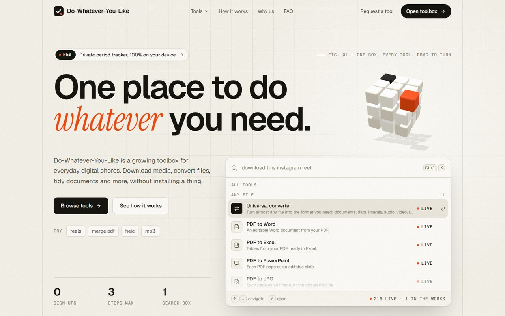</a>
</p>

---

## 📚 Contents

| Start here | Understand it | Build with it |
| :--- | :--- | :--- |
| [👋 What is it](#-what-is-do-whatever-you-like) | [🧭 Vision and principles](#-vision-aspiration-and-principles) | [🧱 How it works](#-how-it-works) |
| [🗂️ What's inside](#️-whats-inside) | [🚀 Our pace](#-our-pace) | [🔒 Privacy and safety](#-privacy-and-safety) |
| [🎬 See it in action](#-see-it-in-action) | [🗺️ What's next](#️-whats-next) | [🛠️ Tech stack](#️-tech-stack) |
| [💻 Run it yourself](#-run-it-on-your-computer) | [☁️ Deploy for free](#️-deploy-it-for-free) | [🧪 Testing](#-testing) |
| [📡 API](#-api-reference) | [➕ Add a tool](#-adding-a-new-tool) | [🤝 Contributing](#-contributing) |

---

## 🗂️ What's inside

162 live tools in 9 collections, one place per job: each tool covers every variant of its task (one hash generator for MD5, SHA and CRC; one document viewer for Word, Excel, PowerPoint, CSV and PDF). Click a name to open that collection on the site.

| | Collection | What you can do | Tools |
| :---: | :--- | :--- | :---: |
| 🔁 | [**Any file**](https://do-whatever-you-like.colddsam.com/tools/category/files) | View Word, Excel, PowerPoint, CSV, PDF & 3D models in-browser, convert almost any file, compress, merge, split and inspect or build archives | **14** |
| 📄 | [**PDF tools**](https://do-whatever-you-like.colddsam.com/tools/category/pdf) | Merge, split, compress, edit, sign, protect, OCR and compare PDFs | **20** |
| 🖼️ | [**Image tools**](https://do-whatever-you-like.colddsam.com/tools/category/images) | Compress, resize, crop, remove backgrounds, upscale, vectorise to SVG, frame mockups, blur faces, make memes and icons, a Photoshop-style pro editor | **20** |
| 💻 | [**Developer tools**](https://do-whatever-you-like.colddsam.com/tools/category/developer) | Format, minify and validate code, convert JSON/CSV/YAML/XML/SQL/types, query SQLite & Parquet, hashes, JWT, UUID/ULID, regex, DNS and HTTP checks, cron | **44** |
| ✍️ | [**Text tools**](https://do-whatever-you-like.colddsam.com/tools/category/text) | Smart notepad (paste, inspect & clean text), writing helper, username & handle generator, translator (text, audio & video), WhatsApp chat analyzer, word counter, case & list tools, binary and hex, Morse code, summaries | **18** |
| 🎨 | [**Charts, fonts and colour**](https://do-whatever-you-like.colddsam.com/tools/category/design) | Animated charts, flowcharts, font checker and maker, colour picker & 50–950 scales, SVG optimizer, CSS Grid/Flexbox & UI generators | **10** |
| ⬇️ | [**Media downloads**](https://do-whatever-you-like.colddsam.com/tools/category/downloads) | Save public YouTube, Instagram and Facebook videos, or just their sound | **3** |
| 🎬 | [**Audio and video**](https://do-whatever-you-like.colddsam.com/tools/category/media) | A multi-track **video editor** (keyframes, effects, auto-captions, 4K export), trim & multi-cut on a waveform, remove noise, change volume, waveforms & spectrograms, record your screen, subtitles & caption translation, speech to text, GIFs | **11** |
| 🧰 | [**Everyday utilities**](https://do-whatever-you-like.colddsam.com/tools/category/utilities) | Private period tracker, EMI/SIP/GST calculators, bill splitter, invoice & signature maker, QR codes, converters, clocks, passwords, device tests | **22** |

<details>
<summary><b>📋 The full list of every tool</b> (click to open)</summary>
<br>

<details>
<summary><b>🔁 Any file</b> — 14 tools</summary>
<br>

- [**Universal converter**](https://do-whatever-you-like.colddsam.com/tools/convert-anything) — Turn almost any file into the format you need: documents, data, images, audio, video, fonts and more.
- [**Document viewer**](https://do-whatever-you-like.colddsam.com/tools/document-viewer) — Open Word, Excel, PowerPoint, CSV, ODF and PDF files right in your browser: the right viewer is picked for each file.
- [**3D model viewer & inspector**](https://do-whatever-you-like.colddsam.com/tools/3d-viewer) — Inspect GLB, GLTF, STL, OBJ (+MTL), FBX, PLY, 3MF & ZIP 3D files with orbit, slicing, mesh tree and exports.
- [**PDF to Word**](https://do-whatever-you-like.colddsam.com/tools/pdf-to-word) — An editable Word document from your PDF.
- [**PDF to Excel**](https://do-whatever-you-like.colddsam.com/tools/pdf-to-excel) — Tables from your PDF, ready in Excel.
- [**PDF to PowerPoint**](https://do-whatever-you-like.colddsam.com/tools/pdf-to-powerpoint) — Each PDF page as an editable slide.
- [**PDF to JPG**](https://do-whatever-you-like.colddsam.com/tools/pdf-to-jpg) — Each page as an image, or the pictures inside.
- [**Word to PDF**](https://do-whatever-you-like.colddsam.com/tools/word-to-pdf) — Turn DOC and DOCX files into PDF.
- [**PowerPoint to PDF**](https://do-whatever-you-like.colddsam.com/tools/powerpoint-to-pdf) — Turn slides into a PDF, one page per slide.
- [**Excel to PDF**](https://do-whatever-you-like.colddsam.com/tools/excel-to-pdf) — Turn spreadsheets into PDF.
- [**Compress files**](https://do-whatever-you-like.colddsam.com/tools/compress-files) — Make any file smaller: PDF, Word, PowerPoint, Excel, photos, audio, video and more.
- [**ZIP, TAR & GZ archive tool**](https://do-whatever-you-like.colddsam.com/tools/archive-extractor-creator) — Inspect archive contents, preview files inside or bundle multiple files into .zip, .tar, .tar.gz or .gz in your browser.
- [**Merge files**](https://do-whatever-you-like.colddsam.com/tools/merge-files) — Combine Word, PowerPoint, Excel, CSV, PDF, audio or video files into one.
- [**Split files**](https://do-whatever-you-like.colddsam.com/tools/split-files) — Break Word, PowerPoint, Excel, CSV, PDF, audio or video into parts.

</details>

<details>
<summary><b>📄 PDF tools</b> — 20 tools</summary>
<br>

- [**PDF toolkit**](https://do-whatever-you-like.colddsam.com/tools/pdf) — Merge, split, rearrange and compress PDFs in seconds.
- [**Merge PDF**](https://do-whatever-you-like.colddsam.com/tools/merge-pdf) — Combine PDFs into one, in the order you set.
- [**Split & extract PDF pages**](https://do-whatever-you-like.colddsam.com/tools/split-pdf) — Break a PDF into parts, or pull out just the pages you pick as a new PDF.
- [**Organize, rotate & remove PDF pages**](https://do-whatever-you-like.colddsam.com/tools/organize-pdf) — Reorder, rotate and delete pages on a page grid, seeing each one.
- [**Scan to PDF**](https://do-whatever-you-like.colddsam.com/tools/scan-to-pdf) — A guided camera finds the page, straightens it and cleans it up: a crisp, searchable PDF.
- [**Compress PDF**](https://do-whatever-you-like.colddsam.com/tools/compress-pdf) — Make a PDF smaller, at the strength you choose.
- [**Repair PDF**](https://do-whatever-you-like.colddsam.com/tools/repair-pdf) — Recover the pages of a damaged PDF.
- [**OCR PDF**](https://do-whatever-you-like.colddsam.com/tools/ocr-pdf) — Make scanned PDFs searchable and selectable.
- [**PDF to PDF/A**](https://do-whatever-you-like.colddsam.com/tools/pdf-to-pdfa) — An archive-ready PDF for long-term storage.
- [**JPG to PDF**](https://do-whatever-you-like.colddsam.com/tools/jpg-to-pdf) — Turn photos and images into one PDF.
- [**HTML to PDF**](https://do-whatever-you-like.colddsam.com/tools/html-to-pdf) — Save any public web page as a PDF.
- [**Add page numbers**](https://do-whatever-you-like.colddsam.com/tools/page-numbers) — Number pages where you want, how you want.
- [**Add watermark**](https://do-whatever-you-like.colddsam.com/tools/watermark-pdf) — Stamp text or an image over your pages.
- [**Crop PDF**](https://do-whatever-you-like.colddsam.com/tools/crop-pdf) — Trim margins or cut pages down to an area.
- [**Edit PDF**](https://do-whatever-you-like.colddsam.com/tools/edit-pdf) — Add text, images, shapes and drawings.
- [**Unlock PDF**](https://do-whatever-you-like.colddsam.com/tools/unlock-pdf) — Remove a PDF's password and restrictions.
- [**Protect PDF**](https://do-whatever-you-like.colddsam.com/tools/protect-pdf) — Lock a PDF with a password.
- [**Sign PDF**](https://do-whatever-you-like.colddsam.com/tools/sign-pdf) — Draw, type or upload your signature and place it.
- [**Redact PDF**](https://do-whatever-you-like.colddsam.com/tools/redact-pdf) — Black out private details for good.
- [**Compare PDF**](https://do-whatever-you-like.colddsam.com/tools/compare-pdf) — See exactly what changed between two versions.

</details>

<details>
<summary><b>🖼️ Image tools</b> — 20 tools</summary>
<br>

- [**Image studio**](https://do-whatever-you-like.colddsam.com/tools/image) — Compress, resize, convert and cut out images in seconds.
- [**Compress image**](https://do-whatever-you-like.colddsam.com/tools/compress-image) — Make JPG, PNG, GIF, WebP and SVG files smaller.
- [**Upscale image**](https://do-whatever-you-like.colddsam.com/tools/upscale-image) — Enlarge a picture 2× or 4× with AI that redraws the detail.
- [**Remove background**](https://do-whatever-you-like.colddsam.com/tools/remove-background) — Cut out the subject: transparent, a colour, or a soft blur behind.
- [**Meme generator**](https://do-whatever-you-like.colddsam.com/tools/meme-generator) — Captions on a picture, the classic way, in seconds.
- [**Pro photo editor**](https://do-whatever-you-like.colddsam.com/tools/pro-photo-editor) — A free Photoshop-style editor in your browser: layers, masks, retouching, Lightroom-style looks, effects, text, stickers and PSD files.
- [**Photo editor**](https://do-whatever-you-like.colddsam.com/tools/photo-editor) — Filters, light and colour, text, stickers and frames (one tap away from the Pro editor).
- [**Emoji to image**](https://do-whatever-you-like.colddsam.com/tools/emoji-to-image) — Any emoji as a PNG, WebP or SVG, in four styles and any size.
- [**Pixelate image**](https://do-whatever-you-like.colddsam.com/tools/pixelate-image) — Turn a picture into pixel art, or pixelate just a part of it.
- [**Change GIF speed**](https://do-whatever-you-like.colddsam.com/tools/gif-speed) — Speed up or slow down an animated GIF, reverse it or make a boomerang.
- [**Resize image**](https://do-whatever-you-like.colddsam.com/tools/resize-image) — Set an exact size in pixels, or scale by percentage.
- [**Crop image**](https://do-whatever-you-like.colddsam.com/tools/crop-image) — Drag a box on the picture, or type exact pixels.
- [**Rotate image**](https://do-whatever-you-like.colddsam.com/tools/rotate-image) — Turn or flip many images at once, or each on its own.
- [**Convert image**](https://do-whatever-you-like.colddsam.com/tools/convert-image) — Any image (HEIC, PNG, WebP, TIFF, PSD, SVG, RAW, JPG…) to JPG, PNG, WebP or GIF, or several into an animated GIF.
- [**HTML to image**](https://do-whatever-you-like.colddsam.com/tools/html-to-image) — Capture a web page, or HTML you paste, as a picture.
- [**Icon maker**](https://do-whatever-you-like.colddsam.com/tools/icon-maker) — Favicons and app icons for websites, Windows, macOS, iOS and Android, from one picture.
- [**Watermark image**](https://do-whatever-you-like.colddsam.com/tools/watermark-image) — Stamp text or a logo, placed, faded, turned or tiled.
- [**Blur face**](https://do-whatever-you-like.colddsam.com/tools/blur-face) — Find faces and hide them, plus anything else you mark.
- [**Image to SVG vectoriser**](https://do-whatever-you-like.colddsam.com/tools/image-to-svg) — Trace PNG or JPG logos, sketches and icons into crisp scalable SVG vectors in your browser.
- [**Mockup & safe-zone frame**](https://do-whatever-you-like.colddsam.com/tools/mockup-frame-generator) — Frame screenshots inside browser windows or phones, or preview YouTube/Reels/TikTok safe zones.

</details>

<details>
<summary><b>💻 Developer tools</b> — 44 tools</summary>
<br>

[Developer utilities](https://do-whatever-you-like.colddsam.com/tools/dev) · [JSON formatter & validator](https://do-whatever-you-like.colddsam.com/tools/json-formatter) · [JWT decoder](https://do-whatever-you-like.colddsam.com/tools/jwt-decoder) · [Base64 encode & decode](https://do-whatever-you-like.colddsam.com/tools/base64-encoder) · [Regex tester](https://do-whatever-you-like.colddsam.com/tools/regex-tester) · [Unix timestamp converter](https://do-whatever-you-like.colddsam.com/tools/timestamp-converter) · [Diff checker](https://do-whatever-you-like.colddsam.com/tools/diff-checker) · [UUID, ULID & NanoID generator](https://do-whatever-you-like.colddsam.com/tools/uuid-generator) · [URL encoder & query parser](https://do-whatever-you-like.colddsam.com/tools/url-encoder) · [Code formatter](https://do-whatever-you-like.colddsam.com/tools/code-formatter) · [Code minifier](https://do-whatever-you-like.colddsam.com/tools/code-minifier) · [Code validator](https://do-whatever-you-like.colddsam.com/tools/code-validator) · [Card number validator](https://do-whatever-you-like.colddsam.com/tools/card-validator) · [XSD validator](https://do-whatever-you-like.colddsam.com/tools/xsd-validator) · [Code editor](https://do-whatever-you-like.colddsam.com/tools/code-editor) · [Markdown editor](https://do-whatever-you-like.colddsam.com/tools/markdown-editor) · [HTML viewer](https://do-whatever-you-like.colddsam.com/tools/html-viewer) · [XML viewer](https://do-whatever-you-like.colddsam.com/tools/xml-viewer) · [XPath tester](https://do-whatever-you-like.colddsam.com/tools/xpath-tester) · [XSLT transformer](https://do-whatever-you-like.colddsam.com/tools/xslt-transformer) · [JSONPath tester](https://do-whatever-you-like.colddsam.com/tools/jsonpath-tester) · [URI template expander](https://do-whatever-you-like.colddsam.com/tools/uri-template) · [JSON & HTML escape / unescape](https://do-whatever-you-like.colddsam.com/tools/json-escape) · [IEEE-754 float analyser](https://do-whatever-you-like.colddsam.com/tools/ieee-754) · [Hash generator](https://do-whatever-you-like.colddsam.com/tools/hash-generator) · [WordPress password hash](https://do-whatever-you-like.colddsam.com/tools/wordpress-hash) · [Random data generator](https://do-whatever-you-like.colddsam.com/tools/random-generator) · [Random name picker](https://do-whatever-you-like.colddsam.com/tools/random-name-picker) · [DNS lookup](https://do-whatever-you-like.colddsam.com/tools/dns-lookup) · [HTTP header & status checker](https://do-whatever-you-like.colddsam.com/tools/http-headers) · [Open port checker](https://do-whatever-you-like.colddsam.com/tools/open-port-checker) · [API client (Postman alternative)](https://do-whatever-you-like.colddsam.com/tools/api-client) · [HTML link generator](https://do-whatever-you-like.colddsam.com/tools/html-link-generator) · [HTML table generator](https://do-whatever-you-like.colddsam.com/tools/html-table-generator) · [Redirect generator](https://do-whatever-you-like.colddsam.com/tools/redirect-generator) · [Share link generator](https://do-whatever-you-like.colddsam.com/tools/share-link-generator) · [REM to PX converter](https://do-whatever-you-like.colddsam.com/tools/rem-px-converter) · [CSS to Less](https://do-whatever-you-like.colddsam.com/tools/css-to-less) · [ASCII table](https://do-whatever-you-like.colddsam.com/tools/ascii-table) · [Data format converter](https://do-whatever-you-like.colddsam.com/tools/data-format-converter) · [JSON / SQL to code types](https://do-whatever-you-like.colddsam.com/tools/json-sql-to-types) · [Chmod permissions calculator](https://do-whatever-you-like.colddsam.com/tools/chmod-calculator) · [SQLite, CSV & Parquet viewer](https://do-whatever-you-like.colddsam.com/tools/sqlite-csv-parquet-viewer) · [Cron expression explainer](https://do-whatever-you-like.colddsam.com/tools/cron-explainer)

</details>

<details>
<summary><b>✍️ Text tools</b> — 18 tools</summary>
<br>

- [**Smart notepad**](https://do-whatever-you-like.colddsam.com/tools/notepad) — Paste any text and see what's in it: counts, emails, links, numbers, hidden characters and stray spaces, with one-click fixes, find & replace and saved notes.
- [**Writing helper & summarizer**](https://do-whatever-you-like.colddsam.com/tools/writing) — Summarise long text into key points, tighten and rewrite it, or fix grammar, right in your browser.
- [**Username & handle generator**](https://do-whatever-you-like.colddsam.com/tools/username-generator) — Generate tailored usernames from any name or niche, check social & email availability, and discover closest free handles.
- [**Translator**](https://do-whatever-you-like.colddsam.com/tools/translator) — Translate text, spoken audio, or video into 100+ languages — returning translated media files plus copyable input and translated text.
- [**WhatsApp chat analyzer**](https://do-whatever-you-like.colddsam.com/tools/whatsapp-chat-analyzer) — Turn any exported WhatsApp chat into stats, timelines, activity heatmaps, reply speed, top emojis and searchable messages — in your browser.
- [**Text ↔ binary, hex & ASCII converter**](https://do-whatever-you-like.colddsam.com/tools/text-to-binary) — Turn text into binary, hex or ASCII codes, or decode them back into text.
- [**Number ↔ words converter**](https://do-whatever-you-like.colddsam.com/tools/number-to-words) — Spell out any number (with lakh and crore if you like), or turn words back into digits.
- [**Roman numeral converter**](https://do-whatever-you-like.colddsam.com/tools/roman-numerals) — Numbers to Roman numerals and back, 1 to 3999.
- [**Morse code translator**](https://do-whatever-you-like.colddsam.com/tools/morse-code) — Text to Morse and back, with sound you can play.
- [**Morse code audio decoder**](https://do-whatever-you-like.colddsam.com/tools/morse-audio-decoder) — Turn Morse beeps from a recording, a video or your microphone into text.
- [**Upside-down, mirror & reverse text**](https://do-whatever-you-like.colddsam.com/tools/upside-down-text) — Flip text upside down, mirror it, or reverse its letters, words or lines.
- [**Text repeater**](https://do-whatever-you-like.colddsam.com/tools/text-repeater) — Repeat text any number of times, with a separator.
- [**Split text**](https://do-whatever-you-like.colddsam.com/tools/split-text) — Split text by lines, commas, words, a pattern or a length.
- [**Lorem ipsum generator**](https://do-whatever-you-like.colddsam.com/tools/lorem-ipsum) — Placeholder text by paragraphs, sentences or words.
- [**Text to image**](https://do-whatever-you-like.colddsam.com/tools/text-to-image) — Turn text into a PNG, with font, colours and padding.
- [**Word, character & reading time counter**](https://do-whatever-you-like.colddsam.com/tools/word-counter) — Live word, character, sentence, paragraph counts, reading time and Flesch score.
- [**Case converter**](https://do-whatever-you-like.colddsam.com/tools/case-converter) — Convert text across camelCase, snake_case, kebab-case, PascalCase, Title Case and more.
- [**List comparator (set operations)**](https://do-whatever-you-like.colddsam.com/tools/list-comparator) — Compare two lists to find A only, B only, intersection, union and symmetric difference.

</details>

<details>
<summary><b>🎨 Charts, fonts and colour</b> — 10 tools</summary>
<br>

- [**Chart maker**](https://do-whatever-you-like.colddsam.com/tools/chart-maker) — Make 30 kinds of charts from your own data, animate them, and save them as pictures, GIFs, videos or web pages.
- [**Flowchart maker**](https://do-whatever-you-like.colddsam.com/tools/flowchart-maker) — Draw flowcharts and diagrams by dragging shapes or typing text, with animated links and a play-through.
- [**Font checker**](https://do-whatever-you-like.colddsam.com/tools/font-checker) — See, test and validate any font, or find the fonts inside a PDF or Office file.
- [**Font creator**](https://do-whatever-you-like.colddsam.com/tools/font-creator) — Make your own font: draw letters, build a pixel font, or turn your handwriting into a font.
- [**Colour picker**](https://do-whatever-you-like.colddsam.com/tools/color-picker) — Pick colours from any image, PDF, slide deck, document or video, and export the palette.
- [**Contrast checker**](https://do-whatever-you-like.colddsam.com/tools/contrast-checker) — Check any text and background colours against WCAG AA and AAA, with fixes.
- [**CSS generator**](https://do-whatever-you-like.colddsam.com/tools/css-generator) — Gradients, box shadows, border radius, glassmorphism and neumorphism, with a live preview and copy-ready CSS.
- [**SVG optimizer & JSX converter**](https://do-whatever-you-like.colddsam.com/tools/svg-optimizer-jsx) — Minify raw SVG paths, strip bloat and convert attributes for React JSX/TSX or CSS Data URIs.
- [**CSS Grid & Flexbox playground**](https://do-whatever-you-like.colddsam.com/tools/css-grid-flexbox-playground) — Visual layout builder with live cells that outputs Tailwind classes, CSS and HTML.
- [**Color palette & 50–950 scale generator**](https://do-whatever-you-like.colddsam.com/tools/color-palette-scale-generator) — Generate full Tailwind 50–950 colour scales, WCAG badges and harmonious palettes from one hex colour.

</details>

<details>
<summary><b>⬇️ Media downloads</b> — 3 tools</summary>
<br>

- [**YouTube downloader**](https://do-whatever-you-like.colddsam.com/tools/youtube) — Save videos and Shorts in the quality you pick, or just the audio as MP3 or M4A.
- [**Instagram downloader**](https://do-whatever-you-like.colddsam.com/tools/instagram) — Reels, posts and carousels, or just a reel's audio, straight from a link.
- [**Facebook downloader**](https://do-whatever-you-like.colddsam.com/tools/facebook) — Grab public videos and reels, or just their audio, without the hassle.

</details>

<details>
<summary><b>🎬 Audio and video</b> — 12 tools</summary>
<br>

- [**Music studio**](https://do-whatever-you-like.colddsam.com/tools/music-studio) — Describe a song and get it produced, with lyrics and a sung vocal, then record, arrange, mix, master and export in a multi-track studio: piano roll, drum sequencer, 26 instruments, 14 effects, Audacity-style editing, stems and MusicGen on the device.
- [**Video editor**](https://do-whatever-you-like.colddsam.com/tools/video-editor) — Edit on a multi-track timeline with Premiere's trim tools, keyframes, 29 effects, 18 transitions, speed curves, voice effects, text to speech, auto-captions in 99 languages and AI clean-up, then export MP4, WebM, GIF or audio up to 4K. Runs in your browser.
- [**Song finder**](https://do-whatever-you-like.colddsam.com/tools/song-finder) (Beta) — Sing a line, hum the tune, play the song nearby or type lyrics you half-remember, and get the song with its lyrics (the matching line highlighted), a 30-second preview and the music video. Every answer is checked against the song's real lyrics.
- [**Video to frames**](https://do-whatever-you-like.colddsam.com/tools/video-to-frames) — Split a video into still frames: pick how many, which part and the format.
- [**Video to GIF**](https://do-whatever-you-like.colddsam.com/tools/video-to-gif) — Turn a clip into a GIF: trim it, set the size, smoothness, speed and loop.
- [**Trim & cut video or audio**](https://do-whatever-you-like.colddsam.com/tools/trim-media) — Cut a video or audio file cleanly or split it into multiple parts on a waveform timeline, in your chosen format.
- [**Noise remover**](https://do-whatever-you-like.colddsam.com/tools/noise-remover) — Remove background noise, hiss, hum and clicks from audio or a video's sound.
- [**Volume booster & normaliser**](https://do-whatever-you-like.colddsam.com/tools/audio-volume) — Make audio or a video louder or quieter, even out the loudness, or mute a video.
- [**Screen & voice recorder**](https://do-whatever-you-like.colddsam.com/tools/screen-recorder) — Record your screen, a window or a tab with your voice, or just your voice.
- [**Subtitle editor**](https://do-whatever-you-like.colddsam.com/tools/subtitle-editor) — Fix subtitle timing, translate captions into 100+ languages, sync to a video, and save as SRT or VTT.
- [**Audio waveform & spectrogram**](https://do-whatever-you-like.colddsam.com/tools/audio-waveform-generator) — Turn any audio clip into a downloadable SVG/PNG waveform or STFT frequency spectrogram.
- [**Video to MP3**](https://do-whatever-you-like.colddsam.com/tools/audio) — Pull a clean MP3 out of any video file.
- [**Audio to text**](https://do-whatever-you-like.colddsam.com/tools/audio-to-text) — Turn speech into text you can edit, translate into 100+ languages, copy or subtitle.

</details>

<details>
<summary><b>🧰 Everyday utilities</b> — 22 tools</summary>
<br>

- [**Period tracker**](https://do-whatever-you-like.colddsam.com/tools/period-tracker) — Track your period, see when the next one is due, and log symptoms and moods. Private: it never leaves your phone.
- [**QR generator**](https://do-whatever-you-like.colddsam.com/tools/qr) — Turn links, Wi-Fi, contacts and more into a crisp QR code.
- [**Scientific calculator**](https://do-whatever-you-like.colddsam.com/tools/scientific-calculator) — Trig, logs, powers, factorials, memory and history, with units too.
- [**Screen resolution & window size**](https://do-whatever-you-like.colddsam.com/tools/screen-resolution) — Your screen's resolution, pixel ratio and colour depth, and the browser window's live size.
- [**Responsive tester**](https://do-whatever-you-like.colddsam.com/tools/screen-resolution-tester) — See a website in 30+ real device frames, or at any custom size.
- [**Webcam test**](https://do-whatever-you-like.colddsam.com/tools/webcam-test) — Check your camera works, and see its resolution and frame rate.
- [**Pixel ruler**](https://do-whatever-you-like.colddsam.com/tools/pixel-ruler) — Measure anything on screen in pixels.
- [**What is my IP**](https://do-whatever-you-like.colddsam.com/tools/my-ip) — Your public IP address and what it says about your connection.
- [**Mic & speaker test**](https://do-whatever-you-like.colddsam.com/tools/mic-speaker-test) — Check your microphone with a live level meter, and your speakers left and right.
- [**Dead pixel test**](https://do-whatever-you-like.colddsam.com/tools/dead-pixel-test) — Full-screen colours to spot dead or stuck pixels, and a flasher to try to fix them.
- [**Unit & currency converter**](https://do-whatever-you-like.colddsam.com/tools/unit-converter) — Length, weight, temperature, area, volume, speed, data and more, plus live currency rates.
- [**World clock & time zones**](https://do-whatever-you-like.colddsam.com/tools/world-clock) — The time in any city, and a meeting planner across time zones.
- [**Stopwatch, countdown & Pomodoro timer**](https://do-whatever-you-like.colddsam.com/tools/stopwatch) — A stopwatch with laps, a countdown with an alarm, and Pomodoro focus sessions.
- [**Age & date calculator**](https://do-whatever-you-like.colddsam.com/tools/age-calculator) — Your exact age and next birthday, the days between two dates, or a date plus or minus some time.
- [**Password generator & checker**](https://do-whatever-you-like.colddsam.com/tools/password-generator) — Strong passwords and memorable passphrases, and an honest strength check.
- [**Encrypt a note**](https://do-whatever-you-like.colddsam.com/tools/encrypt-note) — Lock a message with a password (AES-256), and share it as text or a link.
- [**Photo metadata viewer & remover**](https://do-whatever-you-like.colddsam.com/tools/exif-remover) — See the hidden GPS, camera and date in photos, and remove it without losing quality.
- [**QR code scanner**](https://do-whatever-you-like.colddsam.com/tools/qr-scanner) — Read a QR code from a picture, a screenshot or your camera.
- [**EMI, SIP & interest calculator**](https://do-whatever-you-like.colddsam.com/tools/emi-sip-calculator) — Loan EMIs, SIP and step-up SIP returns, and compound interest, with charts and schedules.
- [**GST & Discount calculator**](https://do-whatever-you-like.colddsam.com/tools/gst-percentage-calculator) — Inclusive and exclusive Indian GST (CGST+SGST or IGST), coupon discounts and percentage math.
- [**Trip & Bill splitter**](https://do-whatever-you-like.colddsam.com/tools/bill-splitter) — Settle group trip expenses with minimum transfers or split dinner bills for WhatsApp.
- [**Invoice & Signature generator**](https://do-whatever-you-like.colddsam.com/tools/invoice-signature-generator) — Build GST-ready A4 printable invoices and draw transparent-background PNG signatures.

</details>

</details>

---

## 🎬 See it in action

> Watch the **[76-second YouTube walkthrough](https://youtu.be/Ff1S_6-91dk)** or read the full launch story with screenshots and architecture notes on the **[Do-Whatever-You-Like Blog](https://do-whatever-you-like.colddsam.com/blog)**.

<table>
<tr>
<td width="50%" valign="top">

**📊 Chart maker**: your data, 30 chart types, animated.

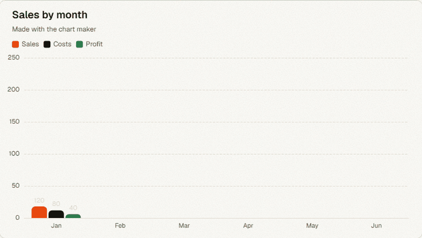

<sub>This GIF was exported by the chart maker itself.</sub>

</td>
<td width="50%" valign="top">

**🔀 Flowchart maker**: drag, connect, and press <i>Play the flow</i>.

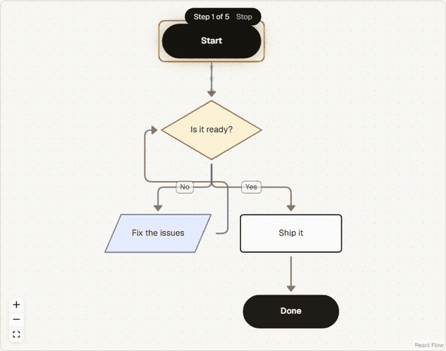

<sub>Moving-dot links and the step-by-step play mode.</sub>

</td>
</tr>
<tr>
<td colspan="2" valign="top">

**🌐 Translator (Text, Audio & Video)**: translate text, subtitles, voice recordings, and videos free — with dubbed media outputs plus copyable input and translated text.

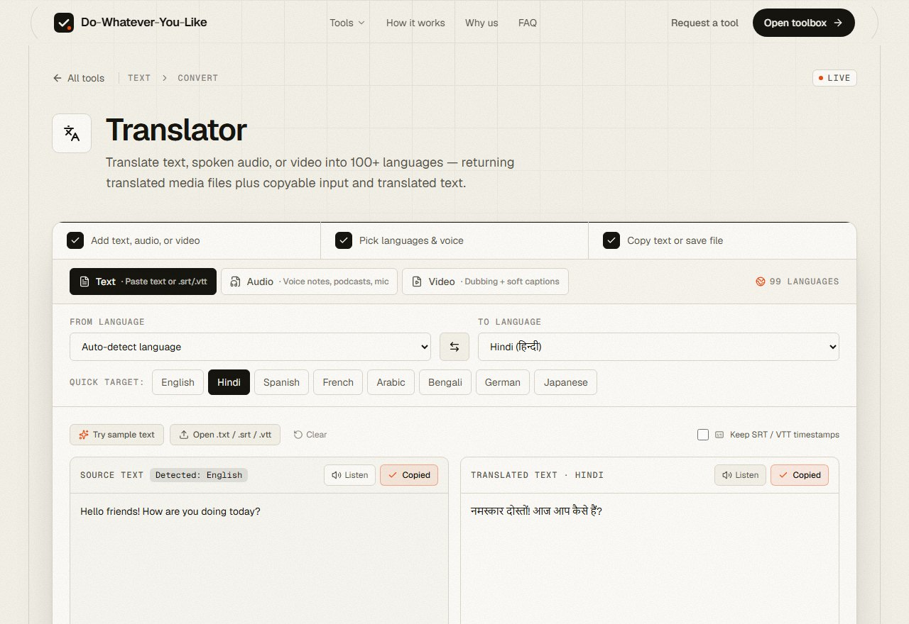

- **Text & subtitles**: Auto-detect language, preserve `.srt` / `.vtt` cue timestamps, listen aloud, or chain output straight back to source.
- **Audio & video dubbing**: Whisper transcription + multi-engine translation + neural voiceover (female/male, synced or fluent timing, optional subtle background mix and soft captions), returning both the dubbed file and copyable transcripts.

</td>
</tr>
<tr>
<td width="50%" valign="top">

**💬 WhatsApp chat analyzer**: `.txt` & `.zip` exports in **any language**, analyzed 100% locally.

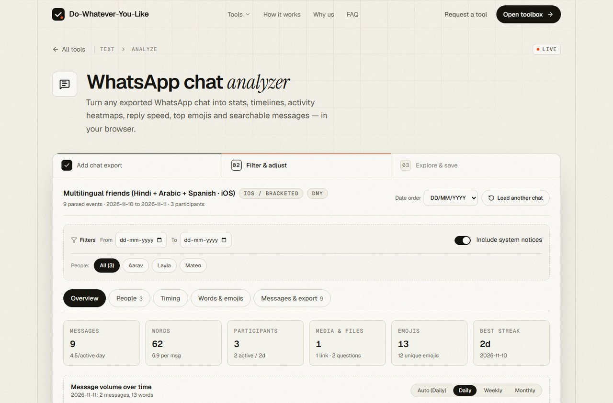

- Supports iOS, Android & Desktop exports in Latin, Hindi, Arabic RTL, CJK, Cyrillic & emojis.
- Timelines, 7×24 activity heatmaps, reply speed, starters, double-texts & searchable messages.
- Free and offline-capable in browser memory — export Excel CSV, JSON & HTML reports.

</td>
<td width="50%" valign="top">

**🌸 Period tracker**: one tap to log, predictions that learn your cycle, and it never leaves your phone.

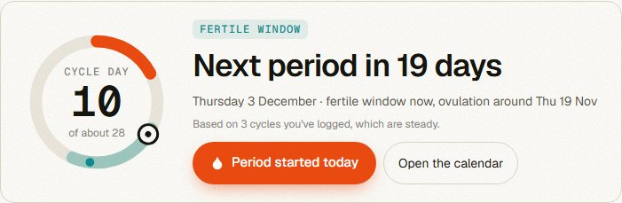

- Log periods, flow, symptoms, mood, pain & notes with cycle predictions.
- Private on-device storage with optional AES-256 PIN lock, backups & calendar reminders.
- General cycle insights, not medical advice or contraception.

</td>
</tr>
<tr>
<td width="50%" valign="top">

**🗂️ Every tool, one task-aware search away**

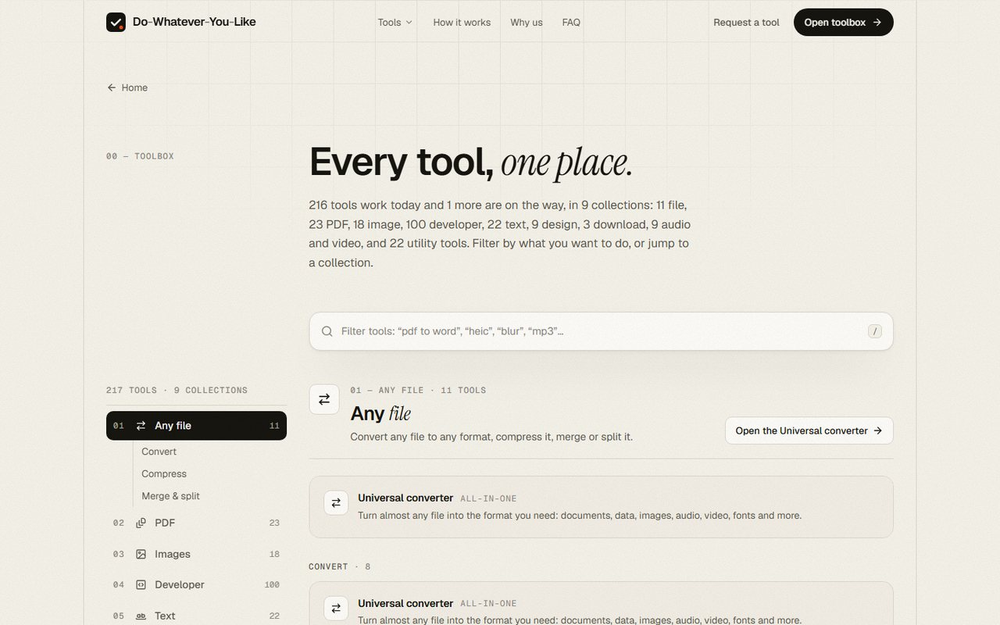

<sub>Type a tool name or describe your task in plain English (like <i>"combine two pdfs"</i> or <i>"remove audio noise"</i>) to get ranked tool & collection suggestions.</sub>

</td>
<td width="50%" valign="top">

**🧩 Each tool on its own page**, with a floating tool hopper (`/`), inline previews, a spec sheet and a guide

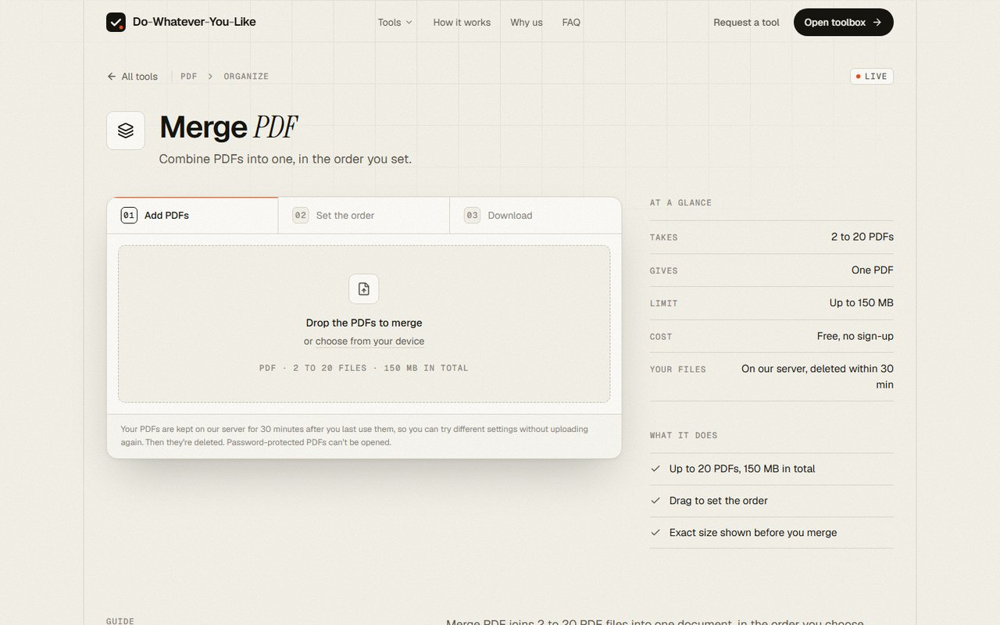

<sub>Hop to any other tool without losing your spot using the morphing search pill that tucks out of the way as you scroll.</sub>

</td>
</tr>
</table>

---

## 🧭 Vision, aspiration and principles

> **Our vision:** one place where anyone can do any small digital job, for free, without signing up, and without worrying about where their files go.

**What we're aiming for**

- 🎯 **The first place you open.** When you need to convert, fix, shrink, check or make something, Do-Whatever-You-Like should already have the tool.
- 🏆 **As good as the paid app.** Each tool should do its one job well enough that you don't need a paid, single-purpose app for it.
- 🌍 **For every kind of person.** A student, a developer, a shop owner and a data analyst should all find what they need, explained in plain words.
- 📱 **Works anywhere.** Phone, tablet or desktop; fast on a slow connection.

**The rules we build by**

| Principle | What it means in practice |
| :--- | :--- |
| 💸 **Free, really** | No accounts, no limits behind a paywall, no watermarks. The whole thing runs on **free hosting tiers** (Vercel + Render), which proves it can stay free. |
| 🔒 **Private by default** | If a tool can run in your browser, it does. If it needs the server, the file lives in a private folder for that one request and is deleted right after. |
| 🧑‍🤝‍🧑 **Plain words** | Buttons say what they do ("Remove the noise", "Download 3 clean photos"). Errors say what went wrong and what to try. |
| 🛡️ **Safe by default** | Every uploaded file is checked by its real contents before anything opens it. A program renamed to `.pdf` is turned away. |
| 🎨 **One design** | Every page follows one design system (`frontend/DESIGN.md`), so all 162 tools feel like one product. |
| 🧩 **Built to grow** | One registry lists every tool; most new tools are one line plus one engine. That's how the site grew so fast. |

---

## 🚀 Our pace

Do-Whatever-You-Like went from an empty repository to **261 tool pages in 10 days**, then folded its near-duplicates into **160 tools** so each job has one place to go, and has grown to **162** since (the Pro photo editor and the Video editor).

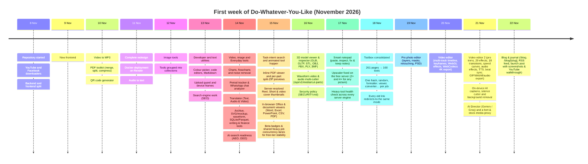

| 📅 Days | 🧰 Live tools | 🗂️ Collections | 📡 API endpoints | 🧪 Check scripts |
| :---: | :---: | :---: | :---: | :---: |
| 13 | 162 | 9 | 83 | 10 backend suites, registry check + browser tests |

---

## 🗺️ What's next

- ✅ **Every listed tool is live.** All 162 tools in the directory — including the new **Video editor** and **Pro photo editor**, the Smart notepad, the Writing helper & summarizer, Office & document viewers, 3D model inspector, and waveform multi-cutter — are now live and ready to use.
- 🧹 **One tool per job.** Pages that only differed by a setting (20 hash pages, 20 random generators, 12 formatters, 6 document viewers, 8 data converters…) are now single tools with the choice inside; 108 old addresses redirect permanently to the same mode, so bookmarks and search results still work.
- 🙋 **Your requests.** The site has a *Request a tool* button. New tools are picked from what people ask for.
- 🔧 **Making the existing tools better**: faster on free hosting, clearer wording, and better phone layouts.

Have an idea? [Open an issue](https://github.com/colddsam/do-whatever-you-like/issues) or use *Request a tool* on the site.

---

## 🧱 How it works

The site has two parts: a **website** (Next.js, on Vercel) and a **processing server** (FastAPI, on Render). Many tools never touch the server at all.

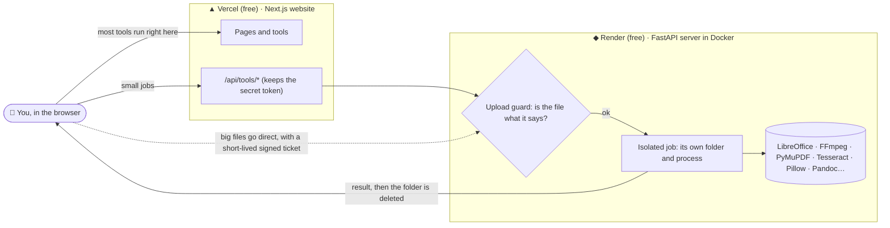

**What happens to a file you upload**

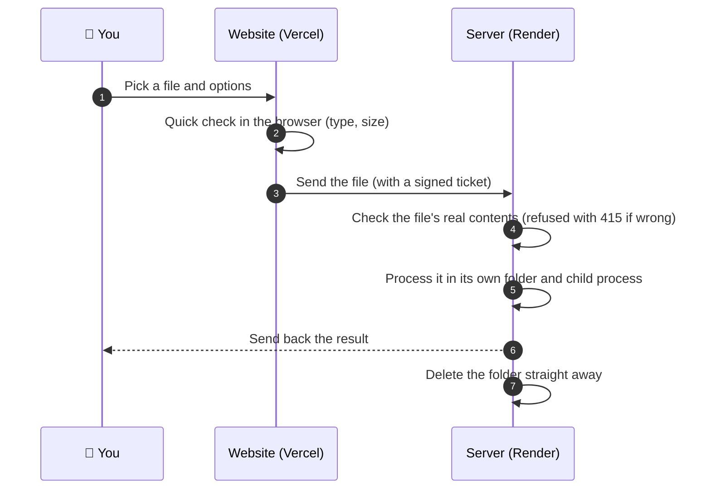

**Where each kind of tool runs**

| Runs in your browser (file never leaves your device) | Runs on our server (deleted after use) |
| :--- | :--- |
| **Video editor** (timeline, keyframes, effects, export, and its AI: captions, silence cut, background removal), **Pro photo editor** (layers, retouching, looks, effects, PSD), developer and text converters & analyzers, **smart notepad**, **SQLite/CSV/Parquet viewer**, **writing helper**, **WhatsApp chat analyzer**, **ZIP/TAR/GZ archive tool**, **image to SVG vectoriser**, **mockup & safe-zone frame**, **audio waveform & spectrogram**, chart maker, flowchart maker, SVG optimizer & CSS playgrounds, **period tracker**, EMI/SIP/GST calculators, bill splitter & invoice generator, QR scanner, photo metadata remover, password generator, encrypted notes, Markdown editor, video to GIF/frames, screen recorder, subtitle editor (with instant inline translation via API), Morse decoder, device tests and timers | PDF tools, universal converter, compress/merge/split, image AI (background removal, upscaling, face blur, and the Pro editor's Select subject / background / upscale), audio to text, **translator (text, audio & video dubbing)**, media downloads, trim/volume/noise removal, font and colour inspection, DNS and HTTP checks, the video editor's AI Director and font/stock proxy |


### 🎨 Pro photo editor

A layer-based, Photoshop- and Lightroom-style editor at [`/tools/pro-photo-editor`](https://do-whatever-you-like.colddsam.com/tools/pro-photo-editor). It runs **entirely in the browser**, so it adds no load to the free Render server and costs nothing extra on Vercel.

| Area | What's there |
| :--- | :--- |
| **Layers** | Pixel, text, shape and adjustment layers · 17 blend modes · opacity · layer masks (paint black/white, from selection, apply, disable) · clipping masks · lock / lock transparency · layer styles (drop shadow, outer glow, stroke, colour overlay) · duplicate, merge down, merge visible, flatten, drag to reorder |
| **Selections** | Rectangle and ellipse marquee, lasso, polygonal lasso, magic wand (tolerance, contiguous, all layers), colour range, Select subject (AI) · add / subtract / intersect · feather, expand, contract, invert · move the outline |
| **Paint & retouch** | Brush and pencil (pen pressure), eraser, gradient (5 kinds), paint bucket, clone stamp, healing brush, spot healing, red eye, smudge, blur, sharpen, dodge, burn, sponge, liquify · content-aware fill (OpenCV.js inpainting in a worker) |
| **Lightroom-style** | 22 one-tap **Looks** with live thumbnails and an amount slider · Camera Raw (exposure, contrast, highlights, shadows, whites, blacks, temperature, tint, vibrance, saturation, texture, clarity, dehaze, vignette, grain) · Curves · Levels · HSL Color Mixer · Color Grading · hold-to-compare before/after |
| **Adjustments** | Brightness/Contrast, Exposure, Vibrance, Hue/Saturation, Color Balance, Black & White, Photo Filter, Channel Mixer, Selective Color, Gradient Map, Shadows/Highlights, Posterize, Threshold, Invert, Desaturate, Equalize, Auto Tone/Contrast/Color (most also as editable adjustment layers) |
| **Filters & effects** | Gaussian, motion, radial and tilt-shift blur · unsharp mask, high pass · noise, median · mosaic, colour halftone · emboss, find edges, oil paint, solarize · twirl, pinch/bulge, wave, ripple, polar coordinates · clouds, vignette · glitch, RGB split, pencil sketch, cartoon, duotone, neon edges, dreamy glow, light leak, pop art |
| **Create** (Picsart/Canva-style) | Text styles (headline, outline, neon, label, poster, handwritten…) · stickers · 8 frames · collage from 2–9 photos · portrait background blur / replace / remove · text and shape tools |
| **Image** | Crop (ratios), free transform (scale, rotate, flip; text stays editable), image size, canvas size, rotate/flip canvas, trim, AI upscale 2×/4× |
| **Files** | Opens JPG, PNG, WebP, GIF, AVIF, SVG, **PSD** (ag-psd) and `.dwlp` projects · exports PNG/JPG/WebP (quality, 10–400% size, exact file size shown) · saves **PSD with layers** and `.dwlp` projects · clipboard copy/paste · autosave to IndexedDB with *Continue editing* |
| **Workflow** | 60-step history panel · Photoshop shortcuts · full screen · pinch zoom and a phone layout · histogram and colour info |

**Connected to the other image tools:** single-image results from Compress, Resize, Crop, Convert, Upscale, Remove background and the rest show **Edit in Pro editor**, and the simple Photo editor offers *Continue in the Pro photo editor*. The picture is handed over through the browser's IndexedDB (`lib/handoff.ts`), never uploaded again.

**What uses the server:** only *Select subject*, *Remove / blur / replace background* and *Upscale (AI)*. They call the existing `/image/remove-background` and `/image/upscale` endpoints, and the editor sends a copy no larger than 2048 px for cut-outs to keep the free instance's memory low.

**Not included:** layer groups (PSD groups are flattened on open), 3D, video timelines, actions and vector pen paths. In a PSD, adjustment layers are applied to the flat preview but not kept as layers, and layer styles are baked into the pixels; the `.dwlp` project keeps everything editable.

Code lives in `frontend/src/components/tools/image/pro/` (engine: `render.ts`, `paint.ts`, `selection.ts`, `adjustments.ts`, `filters.ts`, `looks.ts`, `create.ts`, `io.ts`, `inpaint.ts`; UI: `editor.tsx`, `panels.tsx`, `tools.tsx`, `dialogs.tsx`, `ui.tsx`) and `frontend/public/photo/inpaint-worker.js`. Design notes are in `frontend/DESIGN.md`.

### 🔌 API client

A free, open-source Postman alternative at [`/tools/api-client`](https://do-whatever-you-like.colddsam.com/tools/api-client) (short link: `/api-client`; the old `/tools/api-tester` redirects here). Collections, environments and history live in the browser's IndexedDB; requests go out from the browser, or through our server when an API doesn't allow cross-origin calls.

| Area | What's there |
| :--- | :--- |
| **Workspace** | **Quick search (Ctrl/⌘+K)** for any request, folder, collection, environment, recent request or command · multiple workspaces · tabs with drafts (closing unsaved work asks first), unsaved dots and Postman's preview tabs · collections with nested folders (drag and drop, rename, duplicate, move) · history grouped by day · console (network + `console.log`) · cookie manager · code panel · resizable sidebar, console and request/response split (stacked or two-pane) · full screen · keyboard shortcuts |
| **Requests** | Every HTTP method (custom ones too) · query params ⇄ URL sync · `:path` variables · headers with suggestions and the auto-generated ones shown · bodies: form-data (with files), x-www-form-urlencoded, raw (JSON, XML, HTML, JS, text, with Beautify), binary file, GraphQL (schema introspection and a click-to-build query explorer) · paste a cURL command into the URL bar · per-request settings (redirects, original method, auth header on redirect, SSL verification, URL encoding, cookie jar, max redirects, timeout) |
| **Variables** | Globals, collection, environment, iteration data and local scopes with Postman's precedence · initial vs current values · secret type · a vault (`{{vault:name}}`) · ~100 dynamic variables (`{{$guid}}`, `{{$randomEmail}}`…) · green/red highlighting, hover cards and `{{` autocomplete everywhere · a quick look listing the environment, the open collection's variables and globals · every send warns about `{{variables}}` that didn't resolve |
| **Authorization** | Inherit, No auth, API key, Bearer, Basic, Digest (challenge answered automatically), OAuth 1.0 (HMAC/RSA/PLAINTEXT), OAuth 2.0 (authorization code, PKCE, implicit, password, client credentials, refresh, saved tokens), Hawk, AWS Signature v4, NTLM (handshake done by our server), Akamai EdgeGrid, JWT Bearer (HS/RS/PS/ES), ASAP · at request, folder or collection level |
| **Scripts & tests** | Pre-request and post-response scripts at collection, folder and request level, run in a sandboxed worker with a time limit · Postman's `pm` API (variables, request/response, `pm.test`, `pm.expect` (chai), `pm.response.to.have.*`, JSON schema (ajv), `pm.sendRequest`, cookie jar, vault, `pm.execution.setNextRequest/skipRequest`, visualizer) plus CryptoJS, lodash, uuid, xml2Json and the legacy `tests[]`/`postman.*` API · snippet library · **Generate tests** from the last response |
| **Responses** | Pretty / Raw / Preview (HTML, images, PDF, audio, video) / Visualize / live **Events** for server-sent events · JSONPath filter, find, wrap, copy · headers, cookies, test results, timeline with the redirect chain · status meaning, timing waterfall (DNS, TCP, TLS, TTFB, download), sizes, TLS certificate · save as example, save to file, send and download · **Set as variable** from a selected value or a JSONPath result · "Explain" summary |
| **Runner & performance** | Run a collection or folder: pick and reorder requests, iterations, delay, CSV/JSON data files, environment, persist variables, stop on failure, results per iteration with filters, export · performance tests with virtual users and fixed/ramp/spike/peak profiles, live response-time and throughput charts, P90/P95/P99 per request |
| **Mocks, monitors, flows** | Mock servers that answer from saved examples (Postman's matching, `x-mock-response-name/code`, delays, dynamic bodies, call log) · monitors that run a collection on a schedule while the tool is open, with history and failure notifications · Flows: a visual canvas of Start, Send request, Evaluate, If, For each, Delay, Template, Set variable, Display and Output blocks |
| **Docs & specs** | Generated collection documentation (with code examples in any language) to view or download as HTML · OpenAPI editor with live validation that generates a collection |
| **Import & export** | Postman collections v1/v2.0/v2.1, environments and data dumps · OpenAPI 3 and Swagger 2 (JSON or YAML, from a file, text or link) · HAR · Insomnia · cURL (bash and Windows cmd) · export Postman v2.1, OpenAPI 3 (YAML/JSON), environments, docs, a full workspace backup · share links that carry the collection inside the URL fragment |
| **Code** | 25 snippet targets: cURL, HTTPie, wget, PowerShell, raw HTTP, fetch, XHR, jQuery, Axios, Node, Python (requests, http.client), Go, Java (OkHttp, HttpClient), Kotlin, C#, PHP (cURL, Guzzle), Ruby, Swift, Dart, Rust, C (libcurl), R |
| **Protocols** | HTTP · GraphQL · WebSocket · Socket.IO (v2–v4, namespaces, auth, acks) · MQTT 3.1.1/5.0 over WebSocket (QoS 0–2, retain, last will) · gRPC (unary and streaming, `.proto` or server reflection, metadata, trailers) over HTTP/2 through our server or gRPC-Web from the browser · server-sent events |

**Agents.** *Cloud* (our server, `/api/v1/apiclient/send`): no CORS limits, full timings and TLS details, cookies, NTLM; public addresses only, 3 MB bodies, 55 s. *Browser*: reaches localhost and your own network with no size limit, but the API must allow CORS. *Auto* picks Browser for private addresses. Load tests always use the browser.

**Not possible in a web page**, so not here: proxies and client certificates (mTLS), capturing traffic (Interceptor), and team cloud sync (share links and exports cover sharing). Mock servers and monitors work inside the tool (they aren't on the public internet, and monitors run while a tab is open).

Code lives in `frontend/src/features/api-studio/` (`lib/`: engine, agents, auth, body, variables, cookies, script sandbox worker, runner, mocks, importers/exporters, codegen, GraphQL, gRPC, realtime clients, flows, docs; `ui/`: the workspace) and `backend/app/*/apiclient.py`.

---

### 🎹 Music studio

A Suno/MusicGPT + BandLab/GarageBand + Audacity-style studio at [`/tools/music-studio`](https://do-whatever-you-like.colddsam.com/tools/music-studio) (short links: `/music`, `/music-studio`). Every sound is synthesised, mixed and exported **in the browser**; recordings and imports stay in the browser's IndexedDB and are never uploaded.

| Area | What's there |
| :--- | :--- |
| **AI songs** (Suno, MusicGPT, MusicAI) | Describe a song (genre and mood optional, 15 s–5 min): a free LLM (Groq, falling back to Gemini) plans the title, tempo, key, sections, Roman-numeral chords and original lyrics in 15 languages; the browser writes every part (genre grooves with fills, bass, voice-led chords, pad, arpeggio, a melody with one note per syllable) and **sings the lyrics**: free neural voices (Edge, via our server) are time-stretched onto the melody and pitch-corrected note by note, with vibrato and a harmony on choruses, or rapped on the beat. Paste your own lyrics, or have the AI write them. Without an AI key (or when the free quota is used up) a built-in composer does it all offline |
| **Backing music** (Canva/Soundraw, Mubert) | Royalty-free tracks in **18 genres** and 12 moods with an energy control, fitted to an exact length up to 10 minutes or to a video's duration, as a new project or under the current song · **image to music** (colour, brightness and contrast pick genre, mood, tempo and key) · **MusicGen** (Meta, via Transformers.js) text-to-audio running on the device (the ~450 MB model downloads once) |
| **Instruments** (GarageBand, FL Studio Mobile) | 26 instruments (grand piano, e-piano, organ, guitar, harp, sitar, marimba, bells, kalimba, leads, supersaw, stabs, arp, pads, strings, choir, brass, flute, five basses incl. 808 and acid) and a sampler that plays your own recording · 7 drum kits (808, trap, house, electro/909, acoustic, rock, lo-fi) · all synthesised on the device (additive, FM, Karplus–Strong, subtractive), loudness-calibrated so presets sit together |
| **Write & play** | Multi-track arrangement with sections, loop region, snapping and zoom · **piano roll** (draw, select, move, resize, velocity lane, quantise, transpose, humanise, legato, scale highlighting) · **step sequencer** (12 drums × 16 steps, accents, swing, grooves per genre) · on-screen keys, **chord pads** in the song's key, **musical typing** and **MIDI keyboards** (Web MIDI), sustain pedal · generated **loops** in the song's key |
| **Record** (BandLab, n-Track) | Microphone recording through an AudioWorklet with latency compensation, count-in, metronome, input meter and monitoring · MIDI recording onto armed instrument tracks · tap tempo and a chromatic **tuner** |
| **Mix & master** | Per-track volume, pan, mute/solo, **14 effects** (EQ, compressor, reverb, delay with ping-pong, chorus/doubler, phaser, distortion, filter with LFO, tremolo, auto-pan, bitcrusher, stereo width, robot ring-mod, limiter) and 12 one-tap chains (Clean vocal, Pop star, Podcast, Radio, Telephone, Robot, Big hall, Echo, Lo-fi, Underwater, Guitar amp, Wide synth) · volume automation · **ducking** under any track · 5 **mastering** chains (Universal, Fire, Clarity, Tape, Podcast) and export loudness to −9/−14/−16/−23 LUFS (ITU-R BS.1770) · live meters |
| **Audio editor** (Audacity) | Waveform and spectrogram · cut, copy, paste, delete, silence, trim · fades, normalise, amplify, reverse, invert · speed, tempo (pitch kept) and pitch (length kept) · **noise reduction** with a noise profile, rumble filter, leveller, **truncate silence** · **auto-tune** (hard or natural) to the song's key · echo, bass boost · **vocal remover** · mono and channel swap · every edit is undoable |
| **AI tools** | **Stem splitter** (vocals, drums, bass, other: harmonic/percussive separation with centre and band splits, not a neural network) · **hum/sing to MIDI** · tempo and key detection · bounce a track to audio |
| **Podcasts & stories** (Mubert Cast, Audacity) | Podcast and audio-story templates · clean every voice recording in one tap · shorten long pauses · a music bed composed for the whole show that dips under the voice · podcast mastering at −16 LUFS · **text to speech** in 25 voices and 15 languages · 18 synthesised sound effects with text search |
| **Export & projects** | **MP3** (LAME in WebAssembly), **WAV** 16/24/32-bit, **AAC**, **Opus**, the whole song or the loop, optional loudness normalisation, **stems** (zip), **MIDI** · autosave and a project list in the browser · `.dwylsong` packages to move a project between devices or share it · import audio, video, MIDI and packages · templates (demo, beat maker, songwriter, podcast, audio story) · phone, tablet and desktop layouts, full screen, shortcuts (`?`) |

**What uses the server:** only the **song planner and lyricist** (your description goes to Groq or Gemini; small JSON comes back) and the singing voice / **text to speech** (the lyric text goes to Microsoft Edge's free voices through `/api/v1/studio/tts`). Both are tiny endpoints that load no models and keep nothing, so the Render free instance's 512 MB is untouched; audio never reaches the server.

**Free-tier limits worth knowing:** Groq's free tier allows on the order of 1,000 song plans a day per model (the planner falls through three free Groq models, then Gemini, then the built-in composer, so it never stops working). The sung vocal is a pitch-corrected speech voice, so it sounds stylised (auto-tune), not like a human singer; for a natural vocal, record one and use the studio's tuning and effects. Stems are signal-processing estimates. MusicGen runs on the CPU and is slow (minutes per clip).

Code lives in `frontend/src/features/music-studio/` (`engine/` audio graph, transport, instruments, drums, effects, DSP, composer, vocals, render, encoders, MIDI, storage; `lib/` theory, project model, templates; `ui/` the workspace), `frontend/public/music/ai-worker.js` (MusicGen) and `backend/app/*/music.py`.

---

### 🎬 Video editor

A Premiere Pro + After Effects + CapCut-style editor at [`/tools/video-editor`](https://do-whatever-you-like.colddsam.com/tools/video-editor) (short link: `/studio`). Decoding, preview, AI and export all run **in the browser**; media is kept in the browser's private storage (OPFS) and never uploaded.

| Area | What's there |
| :--- | :--- |
| **Timeline** (Premiere) | Unlimited video, text and audio tracks (reorder them, lock, hide, mute) · linked picture and sound · magnetic snapping to cuts, the playhead and markers · Premiere's tools: selection (`V`), razor (`C`), **ripple edit** (`B`), **roll edit** (`N`), **slip** (`Y`), **slide** (`U`) and **rate stretch** (`R`) · insert (ripple) or overwrite edits · ripple delete and **close gaps** · rubber-band selection, right-click clip menu, colour labels · In/Out work area (`I`/`O`) that loops and exports on its own · J/K/L shuttle · markers you can name, colour and jump between · zoomable ruler, frame-accurate scrubbing · filmstrips and real waveforms · copy/paste/duplicate · 200-step undo where each drag is one step |
| **Clip tools** (CapCut) | **Speed curves** (Montage, Hero, Bullet, Jump cut, Flash in/out, ramps) with a drag-the-points curve editor, plus constant 0.1×–16× · **reverse** (a backwards copy, picture and sound) · **freeze frame** (`Shift+F`) · flip horizontal/vertical · **canvas blur** behind clips that don't fill the frame · picture-in-picture corners, side-by-side, stacked and 2×2 split-screen layouts · crop |
| **Effects** (After Effects) | **29 GPU effects, each with an icon and a one-line description**, in a searchable library you can click or drag onto clips: colour grade (exposure, contrast, highlights, shadows, saturation, vibrance, temperature, tint, hue, vignette), **LUTs** (12 built-in film looks or your own `.cube`), duotone, posterize, invert · Gaussian, directional and zoom blur, glow, sharpen · pixelate, mirror, kaleidoscope, bulge/pinch, wave, camera shake · glitch, RGB split, VHS, film grain, halftone, light leak · chroma key, luma key, AI background removal, **shape masks** (ellipse, rectangle, band, split, feathered, invertible) · crop, rounded corners with border and drop shadow, cinematic bars · 7 one-tap looks · every setting keyframable |
| **Motion** | Keyframes for position, scale, rotation, opacity, volume and every effect setting · linear, ease-in/out, hold and custom cubic-Bézier easing · graph editor · transform handles on the preview · 11 blend modes (normal, multiply, screen, overlay, soft light, add, darken, lighten, difference, colour burn, colour dodge) |
| **Transitions** | **18**, each with an icon: cross dissolve, dip to black, flash, whip pan, zoom blur, wipe, slide, push, iris, clock wipe, zoom in, spin, blur dissolve, glitch, pixelate, film burn, barn doors, luma dissolve · directions for the moving ones · one click puts one on every cut |
| **Text & graphics** | 14 title presets and 5 caption styles on 20 Google Fonts (incl. Hindi and Bangla) · outline, shadow, box · 18 text animations (fade, pop, slide ×4, zoom in/out, drop, blur in, spin, bounce, flicker, pulse, typewriter, karaoke, word pop) · **shapes** (rectangle, rounded, circle, triangle, star, polygon, heart, arrow, line, frame, highlight) · an animated **progress bar** · 30 emoji **stickers** · colour and **gradient** clips |
| **Sound** | Per-clip **EQ** (bass, mids, treble), low/high cut, compressor, reverb, echo, pan and a speech clean-up filter · **voice changer** (chipmunk, deep, robot, telephone, radio, megaphone, echo, big hall, underwater, alien) · keyframed volume up to +12 dB and fades · **record a voice-over** from the microphone while the video plays · **text to speech** in 30 natural voices and 16 languages, with exact captions from the word timings · **18 sound effects** made on the device (whoosh, riser, impact, pop, ding, shutter, typing, censor bleep…) · **beat sync** (beat markers, optional cut on the beat) · **auto-ducking** of music under speech · **loudness normalisation** to −14/−16/−23 LUFS (ITU-R BS.1770) · stereo meters. Playback and export use the same Web Audio graph, so what you hear is what you get |
| **AI** (CapCut) | Auto-captions with word timing (Whisper via Transformers.js in a worker, WebGPU or WASM): English, **99 other languages**, or translated into English · **translate captions** into another language · **edit by transcript** (delete words to cut the video, remove fillers and repeated words, search what was said) · silence cutter · **scene detection** (splits a clip at its cuts) · **auto reframe** (follows the person when changing shape) · **stabilise** (camera shake measured and smoothed, strength adjustable) · background removal (MediaPipe for people in video, live; RMBG-1.4 for stills) · **AI Director**: type what you want, review the planned edits, apply them as one undo step (it knows every tool above) |
| **Import & record** | Video, audio and pictures by drag and drop, file picker or free stock link · **screen and camera recording** straight into the project · formats browsers can't open (AVI, WMV, FLV, MPEG-1/2, VOB, MXF, ProRes, WMA, AMR…) are **converted on the device** with ffmpeg.wasm (a lossless re-wrap when possible) · `.srt`/`.vtt` subtitles · `.cube` LUTs |
| **Export** | **MP4** (H.264 + AAC), **WebM** (VP9 + Opus), animated **GIF**, sound-only **M4A** or **WAV** · 480p, 720p, 1080p, 1440p or 4K at 24–60 fps, Good/High/Max quality · the whole video or just In–Out · captions as **SRT/VTT**, the current frame as PNG · frames decoded exactly with Mediabunny, drawn by the same WebGL compositor as the preview, encoded with WebCodecs · long exports stream to disk · preview before download, exact size on the button |
| **Workflow** | Autosave to IndexedDB, recent projects · **project files** (`.dwylvideo`, with or without media) to move between computers or back up · proxies for smooth 4K playback · 16:9, 9:16, 1:1, 4:5, 21:9 · full screen · Premiere-style shortcuts (`?` lists them) · phone layout |

**What uses the server:** only the **AI Director** (your request plus clip names and times go to Gemini, or Groq as a fallback; without a key a built-in command parser handles common requests), **text to speech** (the text you type goes to Microsoft Edge's free online voices through our server; the MP3 and its word timings come straight back) and the **font/stock proxy** (Google Fonts and free stock libraries, allowlisted hosts only). All are tiny endpoints under `/api/v1/studio`; they load no models, keep nothing and never see your media. Caption translation uses the site's existing translator.

**Cross-origin isolation:** only the editor page (and its AI worker and converter scripts under `/studio`) is sent `Cross-Origin-Opener-Policy: same-origin` and `Cross-Origin-Embedder-Policy: credentialless` (`frontend/next.config.ts`), which unlocks multi-threaded WASM for the AI. The rest of the site stays unisolated so iframes elsewhere keep working.

**Not included:** nested sequences, multicam, 3D layers, motion tracking and plug-ins. RMBG-1.4 is licensed for non-commercial use. The converter handles files up to 1 GB (it runs in the browser's memory); stabilisation corrects movement, not rotation.

Code lives in `frontend/src/features/video-studio/` (`lib/` timeline and keyframe engines, `store/` zustand store with undo, `engine/` compositor, playback, exporter, storage and AI, `ui/` the workspace) and `frontend/public/studio/ai-worker.js`. Design notes are in `frontend/DESIGN.md`.

---

## 🔒 Privacy and safety

| Promise | How it's kept |
| :--- | :--- |
| 🗑️ **Files are temporary** | Each server job gets its own folder, deleted right after the result is sent (multi-step PDF tools keep an upload for up to 30 minutes so you can try several options). |
| 🛡️ **Upload guard** | Every upload is checked by its real contents (magic numbers, Office file layout, text checks) **before** any program opens it. Programs are never accepted, whatever their name. |
| 🔑 **Secret token stays secret** | The browser never sees the server's token; the website adds it on its own server. Large uploads use short-lived signed tickets instead. |
| 🌐 **No snooping on your network** | Link tools only accept known hosts (YouTube, Instagram, Facebook), the video editor's proxy only Google Fonts and free stock libraries, and network tools only reach public addresses, checked on every redirect. |
| 🧯 **One job can't break another** | Heavy jobs run in their own child process with a time limit, so a crash or a huge file can't take the server down. |
| 📏 **Size limits up front** | Oversized requests are refused before they're read (150 MB for files by default). |
| 🙈 **No accounts, no private content tracking** | Nothing you upload or parse is stored or sold. Aggregate traffic analytics use Vercel Web Analytics and Google Analytics 4 (`G-GVKMN99S3N`) when configured. |

See [SECURITY.md](SECURITY.md) for responsible disclosure, scope, and self-hosting security guidelines.

---

## 🛠️ Tech stack

<table>
<tr><th align="left">Website</th><th align="left">Server</th></tr>
<tr>
<td valign="top">

- **Next.js 16** (App Router, Turbopack) and **React 19**
- **TypeScript 5**, **Tailwind CSS 4**, **motion**, **lenis**, **three**
- **ECharts 6** (charts), **React Flow 12** + **dagre** (flowcharts)
- **fflate** (in-browser ZIP handling), `Intl.Segmenter` (multilingual tokenization)
- **CodeMirror**, **Prettier**, **Terser**, **marked**, **KaTeX**, **Mermaid**
- **opentype.js**, **OpenCV.js** (document scanner, healing / content-aware fill), **ag-psd** (PSD read/write), **jsQR**, **exifr**, **mathjs**, **gifenc**
- Video editor: **WebGL2** (GLSL compositor, 3D LUT textures), **WebCodecs**, **Mediabunny** (demux/decode/mux), **Web Audio** (effects, mixing), **Transformers.js** (Whisper, RMBG), **MediaPipe** (segmentation), **ffmpeg.wasm** (format converter), **gifenc**, **fflate**, **zustand**, **idb-keyval**, OPFS
- Hosted on **Vercel** (free)

</td>
<td valign="top">

- **FastAPI** + **Uvicorn**, **Pydantic v2**, Python **3.13**
- **FFmpeg**, **LibreOffice**, **Pandoc**, **PyMuPDF**, **pdf2docx**
- **Tesseract** (OCR), **Ghostscript**, **Chromium** (web page to PDF)
- **Pillow**, **OpenCV**, **ONNX Runtime** (background removal, upscaling)
- **faster-whisper** or **Groq Whisper** (speech to text), **edge-tts** + **espeak-ng** & multi-engine free translation (dubbing & subtitles)
- **yt-dlp**, **instaloader**
- **Gemini** / **Groq** (free tiers) for the video editor's AI Director
- Shipped as a **Docker** image on **Render** (free plan)

</td>
</tr>
</table>

---

## 💻 Run it on your computer

**You need:** Python **3.11+**, Node.js **20+** and npm. On Windows, two scripts start and stop everything — `.\start-dev.ps1` automatically creates `backend\venv` + installs `requirements.txt` and runs `npm install` in `frontend` on first run if either is missing, then starts both servers.

```powershell
# 1. Get the code
git clone https://github.com/colddsam/do-whatever-you-like.git
cd do-whatever-you-like

# 2. Configure environment files
# create backend/.env with at least this line (see "Settings" below):
#   HEADER_TOKEN=any-long-random-secret
copy frontend\.env.example frontend\.env.local  # set BACKEND_TOKEN to the same value as HEADER_TOKEN

# 3. Start both (auto-installs backend venv + frontend node_modules if missing)
.\start-dev.ps1                       # stop with .\stop-dev.ps1
```

Prefer to install and start them manually (or on macOS/Linux)?

```bash
# Terminal 1: the server
cd backend
python -m venv venv
.\venv\Scripts\Activate.ps1          # macOS/Linux: source venv/bin/activate
pip install -r requirements.txt
python -m uvicorn app.main:app --host 127.0.0.1 --port 8000 --reload

# Terminal 2: the website
cd frontend
npm install
npm run dev
```

Then open **http://localhost:3000**.

<details>
<summary><b>⚙️ Settings (environment variables)</b></summary>
<br>

**Server: `backend/.env`**

| Name | What it's for | Default |
| :--- | :--- | :--- |
| `HEADER_TOKEN` | The secret the website uses to talk to the server. Make it long and random. | (required) |
| `ALLOWED_ORIGINS` | Website addresses allowed to call the server, as a JSON list. | `["http://localhost:3000"]` |
| `DEBUG` | `true` shows the interactive API docs at `/docs`. | `false` |
| `MAX_DOWNLOAD_SIZE_MB` | Largest file accepted or downloaded. | `150` |
| `MAX_VIDEO_DURATION_SECONDS` | Longest video the downloaders accept. | `3600` |
| `AUDIO_MP3_MAX_SECONDS` | Longest download that can be turned into MP3. | `1800` |
| `YOUTUBE_MAX_DOWNLOAD_MB` / `YOUTUBE_MAX_DURATION_SECONDS` / `YOUTUBE_MAX_HEIGHT` | YouTube limits; only qualities under the cap are offered. | `500` / `14400` / `1080` |
| `INSTAGRAM_COOKIE_FILE_PATH` | Signed-in session for Instagram (see [cookies](#-instagram-and-cookies)). | `cookies_instagram.txt` |
| `TRANSCRIBE_GROQ_API_KEY` | Optional free Groq key: fast, accurate speech to text. Without it, Whisper runs on the server. | (empty) |
| `MEDIA_EXACT_TRIM_MAX_SECONDS` / `MEDIA_VIDEO_REENCODE_MAX_SECONDS` | Caps for slow re-encoding jobs on a small server. | `180` / `1800` |
| `PDF_CACHE_TTL_SECONDS` | How long a PDF upload is kept for multi-step PDF tools. | `1800` |
| `IMAGE_UPSCALE_MAX_INPUT_PIXELS` | Upscaling time follows the pixels the AI sees (~36 s per megapixel on one CPU core, for 2× and 4× alike). Bigger pictures are reduced to this before the AI pass, then the result is resized to the size asked for. | `4000000` (Render: `500000`) |
| `SONGID_GROQ_API_KEY` / `SONGID_GEMINI_API_KEY` | Keys for the song finder. Any Groq or Gemini key already set (`TRANSCRIBE_`, `TRANSLATE_`, `STUDIO_`, `MUSIC_`) is reused, so nothing extra is needed. Groq hears the words (Whisper) and names songs; Gemini is the fallback and listens to hums. Without either, the tool says it isn't set up. | (empty) |
| `STUDIO_GEMINI_API_KEY` | Optional free [Gemini key](https://aistudio.google.com/apikey) for the video editor's AI Director. | (empty) |
| `STUDIO_GROQ_API_KEY` | Optional Groq key for the AI Director (fallback). An existing `TRANSLATE_`/`TRANSCRIBE_GROQ_API_KEY` is reused automatically. Without any key, the editor's built-in commands are used. | (empty) |
| `STUDIO_GEMINI_MODEL` / `STUDIO_PROXY_MAX_MB` | Gemini model for the Director; largest file the font/stock proxy passes on. | `gemini-flash-lite-latest` / `200` |
| `IMAGE_UPSCALE_MAX_OUTPUT_PIXELS` | Largest upscaled result; above it the result is made as large as fits. | `16000000` (Render: `12000000`) |

Every tool has its own settings with a prefix (`PDF_`, `IMAGE_`, `UNIVERSAL_`, `COMPRESS_`, `MEDIA_`, `TRANSCRIBE_`…) in `backend/app/config/`. `render.yaml` shows the values tuned for the free plan.

**Website: `frontend/.env.local`**

| Name | What it's for |
| :--- | :--- |
| `BACKEND_URL` | Where the server is, e.g. `http://127.0.0.1:8000`. Server-side only. |
| `BACKEND_TOKEN` | Must equal `HEADER_TOKEN`. Never prefix it with `NEXT_PUBLIC_`. |
| `BACKEND_PUBLIC_URL` | Production only: the server's public address, so big files go straight there (Vercel caps requests at 4.5 MB). |
| `NEXT_PUBLIC_GA_ID` | Optional Google Analytics 4 measurement ID (`G-...`). Set as plain Config in Vercel. |
| `GOOGLE_SITE_VERIFICATION` / `BING_SITE_VERIFICATION` | Optional search-engine ownership tags. |

</details>

---

## ☁️ Deploy it for free

| Part | Where | How |
| :--- | :--- | :--- |
| 🖥️ **Website** | **Vercel** (Hobby, free) | Import the repo, set **Root directory** to `frontend`, add `BACKEND_URL`, `BACKEND_TOKEN` and `BACKEND_PUBLIC_URL`. |
| ⚙️ **Server** | **Render** (free web service) | *New → Blueprint* and pick this repo. `render.yaml` builds `backend/Dockerfile` with every engine included. Copy the generated `HEADER_TOKEN` to Vercel's `BACKEND_TOKEN`, and set `ALLOWED_ORIGINS` to your Vercel address. Optionally add `STUDIO_GEMINI_API_KEY` for the video editor's AI Director. |

> **Good to know about free plans.** Render's free server has 512 MB of memory and a small slice of CPU, and it goes to sleep when nobody uses it, so the first request after a quiet spell can take a minute. That's why slow or memory-heavy jobs (video re-encoding, Whisper, OCR, headless Chromium, LibreOffice) carry a **Beta** badge, run behind a shared heavy-job concurrency lane (`backend/app/core/lanes.py`) so concurrent requests queue safely without crashing, and why everything that can run in the browser does.

### 🍪 Instagram and cookies

Public YouTube and Facebook videos work without anything extra. **Instagram only shares posts with a signed-in session**, so the server needs a cookie file:

1. Use a **spare account**, never your personal one.
2. Log in from a private browser window and export cookies in **Netscape format** (for example with the *Get cookies.txt LOCALLY* extension).
3. Close the window **without logging out** (logging out ends the session).
4. Locally, save it as `backend/cookies_instagram.txt`. On Render, add it under **Environment → Secret Files** with the same name; `render.yaml` already points to `/etc/secrets/`.

Cookie files are git-ignored and never committed. Without one, the Instagram page simply says downloads aren't set up.

---

## 🧪 Testing

Everything new is checked end to end with real files before it ships.

| Check | Command | What it proves |
| :--- | :--- | :--- |
| Website types and style | `cd frontend && npx tsc --noEmit && npx eslint src` | The code compiles and follows the rules |
| Website build | `npm run build` | Every page builds (static and dynamic) |
| Tool registry | `npx tsx --tsconfig tsconfig.json scripts/check-tools.ts` | Merged pages redirect to a live tool and mode, no link names a missing tool, every tool has a workspace, search still finds old names |
| Universal converter | `python scripts/check_universal.py` | Every offered conversion runs and its output opens |
| Compress, merge, split, icons | `python scripts/check_file_tools.py` | Results are opened by independent readers |
| Upload guard | `python scripts/check_upload_guard.py` | Disguised and wrong files are refused, good ones pass |
| No false refusals | `python scripts/check_guard_corpus.py` | Real samples of every format are accepted |
| Audio and video edits | `python scripts/check_media.py` | Trim, volume, mute and noise removal measured with FFmpeg |
| Translator (text, audio, video) | `python scripts/check_translate.py` | Multilingual text, SRT cues, MP3/MP4 dubbing, upload guard and FFprobe validation |
| Request a tool email pipeline | `python scripts/check_tool_request.py` | Validation, header/HTML escaping, honeypot, rate limit, HTTP & SMTP delivery to `contact@colddsam.com` |
| Developer network tools | `python scripts/check_devtools.py` | DNS, HTTP, ports, XSD and XSLT, public addresses only |
| Design tools | `python scripts/check_design_tools.py` | Font and colour inspection |
| Video editor server helpers | in-process ASGI tests | Font/stock proxy allowlist (lookalike domains, loopback, credentials in URLs and HTML pages refused), streaming, AI Director with and without a key, LLM-output sanitising and the new operations, text to speech (validation and a real voice with word timings) |
| Video editor (browser) | Playwright in headless Chrome | COOP/COEP isolation on the editor only, import into linked clips, waveforms and filmstrips, play/split/undo, WebGL grade, silence cut, MediaPipe, Whisper in the worker, proxies, H.264 + AAC export checked with ffprobe, no overflow from phone to desktop · all 29 effects and 18 transitions render (and undo), scene detection, speed curves, freeze frame, reverse, flip, stabilise, auto reframe, shapes and stickers, sound effects, 120 BPM beat detection, loudness, ducking, voice changer, microphone voice-over, text to speech, SRT import/export, transcript cutting, rubber-band selection, ripple trim, tool shortcuts, In/Out, GIF/WAV/WebM/In–Out exports, project files round trip, AVI conversion with ffmpeg.wasm |
| API client relay | in-process ASGI tests | Auth required, method/header validation, private and local addresses refused, custom methods, gzip decoded, redirect chain on and off, binary bodies, Set-Cookie kept, timeouts, expired certificates refused and allowed with verification off, SSE captured for a time window, NTLMv2 against the MS-NLMP test vector, gRPC over HTTP/2 (status, trailers, UNIMPLEMENTED) |
| API client logic | Node (TypeScript) | 46 checks: Digest (RFC 2617), OAuth 1.0 (Twitter's documented signature), AWS SigV4 (AWS test suite), Hawk (spec example), JWT (jwt.io), cURL parsing (bash and Windows cmd), Postman v2.1 round trip, OpenAPI 3/HAR/environment import, OpenAPI export, variables and dynamic variables, cookies, SSE parsing, Handlebars templates, mock matching, 25 code generators, generated tests, GraphQL builder |
| API client (browser) | Playwright in headless Chrome | A 36-step audit that opens every panel, dialog and view on desktop and phone and fails on any console error or React warning · 11 checks for environments (an env-only variable stays unresolved with no environment and the response says so; the runner follows the active environment), quick search, set as variable, copy as cURL, duplicate, typing into the empty key/value row, closing unsaved work, saving from history and the phone menu · 28 checks against live public APIs: params and pre-request scripts, timings and TLS popovers, JSON POST setting a collection variable, path variables, Basic and Digest auth, form-data and urlencoded bodies, GraphQL with introspection, cURL pasted into the URL bar, code snippets, sandboxed scripts (JSON schema, CryptoJS, lodash, async `pm.sendRequest`, a failing test, the visualizer), a runaway script stopped at the time limit, console search and network rows, Save-as, save-as-example feeding a mock server, the runner (3 requests × 2 iterations), OpenAPI import, environments with masked secrets, WebSocket echo, live server-sent events with Stop, share-link round trip, generated docs, no page errors, phone/tablet/laptop layouts without overflow, the old address redirect |
| Song finder | in-process ASGI tests + Node + Chrome | Auth required; empty, one-word, nonsense and invalid input; misheard, romanised-Hindi (spelling variants, joined/split compounds, pasted multi-line verses), Spanish and title-only lyric searches, including songs the AI doesn't know (found by hook and rare-word search in LRCLIB), verified against real lyrics (invented songs dropped, compilations de-duplicated, the matching line picked out); spoken clip → Whisper → the right song; hummed tune → on-device YIN notes (repeated notes, legato, vibrato, low voices, 22–48 kHz) → melody guess in ~8 s; silence, too-short, disguised and wrong-type files refused with clear messages; temp folder empty afterwards; preview playback and YouTube embed; no overflow at 360/768 px |
| Music studio server helpers | in-process ASGI tests | Auth required, input validation, song plans from Groq and Gemini (sanitised genres, instruments, chords, bars fitted to the length), Hindi lyrics, lyric writer, fall-through when a model is retired or over quota |
| Music studio DSP | Node (TypeScript) | FFT round trip, YIN pitch, WSOLA stretch, pitch shift, auto-tune to the chromatic and major scales, BS.1770 loudness against reference values (±0.01 LU), tempo (95/120 BPM), key, noise reduction, harmonic/percussive split, melody transcription |
| Music studio (browser) | Playwright in headless Chrome | 54 checks: isolation, playback reaching the meters, WAV/MP3 export, piano roll, step sequencer, undo, loops, sound effects, microphone recording, every audio edit, stems, tempo/key, bounce, backing tracks, AI song with sung vocal (92% of notes within 0.6 semitone of the melody), image to music, AI lyrics, text to speech, auto-duck, loudness export within 0.05 LU of target, MIDI and `.dwylsong` round trips, templates, musical typing and MIDI recording, hum to MIDI, tuner, MusicGen on the device, phone and tablet layouts · every instrument and kit calibrated to −20/−18 LUFS |
| Music studio instruments | Playwright in headless Chrome | All 25 instruments in tune within 7 cents across four octaves, release to silence, loudness calibrated within 0.3 dB; 7 kits × 12 drums; live play by mouse, touch and three-finger chords on phone, tablet and desktop, quick taps sound and never stick, chord and drum pads, instrument switching, octave tweak, sampler pitch |
| Server-heavy tools (live) | `python scripts/check_heavy_tools.py` | Against a running server: upscaler 2×/4× within Render's caps, background removal, faces, Chromium, OCR, PDF/A, LibreOffice, FFmpeg, Whisper, icons, translation |

Run the backend scripts from `backend/` with the virtual environment's Python. Browser tests (Playwright) drive tool pages with real inputs, check outputs, and audit layouts at phone and desktop widths.

---

## 📡 API reference

83 endpoints, all under `/api/v1`, all needing `Authorization: Bearer <HEADER_TOKEN>`. With `DEBUG=true`, try them at `http://127.0.0.1:8000/docs`, or import `backend/postman_collection.json` into Postman (rebuild it with `python generate_postman.py`).

<details>
<summary><b>Health</b> — 1 endpoint</summary>
<br>

| Method | Endpoint | What it does |
| :--- | :--- | :--- |
| `GET` | `/api/v1/health` | Service health and version check |

</details>

<details>
<summary><b>Tool Request</b> — 2 endpoints</summary>
<br>

| Method | Endpoint | What it does |
| :--- | :--- | :--- |
| `GET` | `/api/v1/tool-request/capabilities` | Active free email delivery channels (`resend`, `brevo`, `web3forms`, `apps_script`, `smtp`, `webhook`, `formsubmit`) |
| `POST` | `/api/v1/tool-request` | Validate, rate-limit and deliver tool request messages to `contact@colddsam.com` |

</details>

<details>
<summary><b>Instagram</b> — 2 endpoints</summary>
<br>

| Method | Endpoint | What it does |
| :--- | :--- | :--- |
| `POST` | `/api/v1/instagram/extract` | Get direct Instagram media URLs, duration and browser-safe cover thumbnails (with FFmpeg first-frame fallback) without saving to disk |
| `POST` | `/api/v1/instagram/download` | Download Instagram media directly (single file or packaged ZIP for carousels) |

</details>

<details>
<summary><b>Facebook</b> — 2 endpoints</summary>
<br>

| Method | Endpoint | What it does |
| :--- | :--- | :--- |
| `POST` | `/api/v1/facebook/extract` | Get direct Facebook video or reel URLs, metadata and browser-safe cover thumbnails without saving to disk |
| `POST` | `/api/v1/facebook/download` | Download public Facebook video or reel directly as an MP4 file |

</details>

<details>
<summary><b>YouTube</b> — 2 endpoints</summary>
<br>

| Method | Endpoint | What it does |
| :--- | :--- | :--- |
| `POST` | `/api/v1/youtube/extract` | Get direct YouTube video or Shorts URLs, metadata and verified cover thumbnails without saving to disk |
| `POST` | `/api/v1/youtube/download` | Download public YouTube video or Short directly as an MP4 file |

</details>

<details>
<summary><b>PDF</b> — 10 endpoints</summary>
<br>

| Method | Endpoint | What it does |
| :--- | :--- | :--- |
| `POST` | `/api/v1/pdf/upload` | Upload a PDF once and get a token to reuse for estimates and actions |
| `POST` | `/api/v1/pdf/merge` | Merge multiple PDFs (uploaded files or tokens) into a single PDF |
| `POST` | `/api/v1/pdf/merge/estimate` | Size of the merged PDF for these uploaded tokens, without returning it |
| `POST` | `/api/v1/pdf/split` | Split a PDF by page ranges (e.g. '1-3, 5') or into individual pages |
| `POST` | `/api/v1/pdf/split/estimate` | The parts (pages and sizes) a split would produce, without returning them |
| `POST` | `/api/v1/pdf/organize` | Reorder, rotate and remove pages (e.g. '3, 1:90, 2') |
| `POST` | `/api/v1/pdf/organize/estimate` | Size of the rearranged PDF, without returning it |
| `GET` | `/api/v1/pdf/thumbnail` | One page of an uploaded PDF as a PNG thumbnail |
| `POST` | `/api/v1/pdf/compress` | Compress a PDF by a target percentage (1-95) |
| `POST` | `/api/v1/pdf/compress/estimate` | Compressed size at several strengths, so a UI can predict any strength |

</details>

<details>
<summary><b>PDF tools</b> — 15 endpoints</summary>
<br>

| Method | Endpoint | What it does |
| :--- | :--- | :--- |
| `POST` | `/api/v1/pdf/page-numbers` | Add page numbers |
| `POST` | `/api/v1/pdf/watermark` | Stamp text or an image over (or under) pages |
| `POST` | `/api/v1/pdf/crop` | Crop pages to a box |
| `POST` | `/api/v1/pdf/edit` | Add text, images, shapes, drawings and signatures to pages |
| `POST` | `/api/v1/pdf/redact/find` | Find text to redact: words, phrases or kinds of detail (emails, phones…) |
| `POST` | `/api/v1/pdf/redact` | Permanently black out areas (text, images and drawings under them are removed) |
| `POST` | `/api/v1/pdf/protect` | Encrypt with a password (AES-256) |
| `POST` | `/api/v1/pdf/unlock` | Remove a PDF's password and restrictions |
| `POST` | `/api/v1/pdf/repair` | Rebuild a damaged PDF and keep every page that can be read |
| `GET` | `/api/v1/pdf/ocr/languages` | Languages text recognition can read on this server |
| `POST` | `/api/v1/pdf/ocr` | Make scanned pages searchable and selectable |
| `POST` | `/api/v1/pdf/from-images` | Images (or phone scans) to one PDF, in order |
| `POST` | `/api/v1/pdf/pdfa` | Convert to PDF/A for long-term archiving |
| `POST` | `/api/v1/pdf/compare` | What changed between two versions: every insertion, deletion and edit, with where it is |
| `POST` | `/api/v1/pdf/compare/report` | Side-by-side PDF with every change marked |

</details>

<details>
<summary><b>Convert</b> — 2 endpoints</summary>
<br>

| Method | Endpoint | What it does |
| :--- | :--- | :--- |
| `GET` | `/api/v1/convert/capabilities` | Which converters this server has installed |
| `POST` | `/api/v1/convert/html-to-pdf` | A public web page (url) or an .html file → PDF |

</details>

<details>
<summary><b>QRCode</b> — 2 endpoints</summary>
<br>

| Method | Endpoint | What it does |
| :--- | :--- | :--- |
| `POST` | `/api/v1/qrcode/generate` | Generate a customizable QR code from text, URL, Wi-Fi, vCard, Email, SMS, Phone, Geo, or Event |
| `POST` | `/api/v1/qrcode/generate-with-logo` | Generate a customizable QR code with an optional center logo image upload |

</details>

<details>
<summary><b>Transcribe</b> — 2 endpoints</summary>
<br>

| Method | Endpoint | What it does |
| :--- | :--- | :--- |
| `GET` | `/api/v1/transcribe/capabilities` | Which speech engine this server uses |
| `POST` | `/api/v1/transcribe` | Transcribe an audio or video file (streams NDJSON events) |

</details>

<details>
<summary><b>Translate</b> — 5 endpoints</summary>
<br>

| Method | Endpoint | What it does |
| :--- | :--- | :--- |
| `GET` | `/api/v1/translate/capabilities` | Supported languages, speech engines and free dubbing limits |
| `POST` | `/api/v1/translate/text` | Auto-detect and translate plain text or `.srt`/`.vtt` subtitles preserving timestamps |
| `POST` | `/api/v1/translate/batch` | Translate transcript segments or subtitle cue lines in batch |
| `POST` | `/api/v1/translate/media` | Transcribe, translate and dub uploaded audio or video (streams NDJSON progress events) |
| `GET` | `/api/v1/translate/result/{token}` | Download the temporary dubbed audio or video file |

</details>

<details>
<summary><b>Image tools</b> — 13 endpoints</summary>
<br>

| Method | Endpoint | What it does |
| :--- | :--- | :--- |
| `GET` | `/api/v1/image/capabilities` | Which image formats and AI tools this server has |
| `POST` | `/api/v1/image/compress` | Compress JPG, PNG, WebP, GIF and SVG images |
| `POST` | `/api/v1/image/resize` | Resize images by pixels or percentage |
| `POST` | `/api/v1/image/crop` | Crop one image to a rectangle (pixels, as seen) |
| `POST` | `/api/v1/image/convert` | Convert images (incl. HEIC, RAW, PSD, SVG, TIFF) to JPG, PNG, WebP or GIF |
| `POST` | `/api/v1/image/gif` | Several images → one animated GIF |
| `POST` | `/api/v1/image/rotate` | Rotate and flip images (pixel-exact) |
| `POST` | `/api/v1/image/watermark` | Stamp text or an image over images |
| `POST` | `/api/v1/image/faces` | Find faces (boxes as fractions of the image) |
| `POST` | `/api/v1/image/blur` | Blur or pixelate areas (faces, plates, text) |
| `POST` | `/api/v1/image/remove-background` | Cut out the subject (transparent, colour or blurred background) |
| `POST` | `/api/v1/image/upscale` | Enlarge an image 2× or 4× with Real-ESRGAN |
| `POST` | `/api/v1/image/html` | Capture a web page (url), pasted HTML or an .html file as an image |

</details>

<details>
<summary><b>Universal converter</b> — 2 endpoints</summary>
<br>

| Method | Endpoint | What it does |
| :--- | :--- | :--- |
| `GET` | `/api/v1/universal/formats` | Every format, and what each can be converted to |
| `POST` | `/api/v1/universal/convert` | Convert any supported file to another format |

</details>

<details>
<summary><b>Compress</b> — 1 endpoint</summary>
<br>

| Method | Endpoint | What it does |
| :--- | :--- | :--- |
| `POST` | `/api/v1/compress` | Make any file smaller (PDF, Office, images, audio, video, fonts, archives…) |

</details>

<details>
<summary><b>Merge and split</b> — 3 endpoints</summary>
<br>

| Method | Endpoint | What it does |
| :--- | :--- | :--- |
| `POST` | `/api/v1/merge-split/inspect` | What a file holds: pages, slides, headings, sheets or length |
| `POST` | `/api/v1/merge-split/split` | Split one file into parts (a ZIP) |
| `POST` | `/api/v1/merge-split/merge` | Merge 2 or more files of one kind, in the order sent |

</details>

<details>
<summary><b>Icon maker</b> — 1 endpoint</summary>
<br>

| Method | Endpoint | What it does |
| :--- | :--- | :--- |
| `POST` | `/api/v1/icon` | Icons for websites, Windows, macOS, iOS, Android and desktop apps |

</details>

<details>
<summary><b>Fonts</b> — 2 endpoints</summary>
<br>

| Method | Endpoint | What it does |
| :--- | :--- | :--- |
| `POST` | `/api/v1/fonts/inspect` | Everything about a font, and whether browsers accept it |
| `POST` | `/api/v1/fonts/document` | Fonts a document uses, embedded or not, with the embedded files |

</details>

<details>
<summary><b>Colour picker</b> — 1 endpoint</summary>
<br>

| Method | Endpoint | What it does |
| :--- | :--- | :--- |
| `POST` | `/api/v1/palette/extract` | Pictures and exact colours of any file, for picking colours |

</details>

<details>
<summary><b>Developer tools</b> — 8 endpoints</summary>
<br>

| Method | Endpoint | What it does |
| :--- | :--- | :--- |
| `POST` | `/api/v1/devtools/dns` | DNS records for a domain |
| `POST` | `/api/v1/devtools/reverse` | The hostname behind an IP address (PTR) |
| `POST` | `/api/v1/devtools/port` | Is this TCP port open on a public host |
| `POST` | `/api/v1/devtools/http` | Send one HTTP request to a public address |
| `POST` | `/api/v1/devtools/xsd` | Validate XML against an XSD schema |
| `POST` | `/api/v1/devtools/xslt` | Transform XML with an XSLT 1.0 stylesheet |
| `POST` | `/api/v1/apiclient/send` | The API client's relay: any method, base64 body, redirects, SSL toggle, NTLM; returns status, headers, base64 body, DNS/TCP/TLS/TTFB/download timings, TLS certificate and redirect hops |
| `POST` | `/api/v1/apiclient/grpc` | One gRPC call over HTTP/2 (unary or streaming): protobuf messages in and out, status, headers and trailers |

</details>

<details>
<summary><b>Audio & video</b> — 4 endpoints</summary>
<br>

| Method | Endpoint | What it does |
| :--- | :--- | :--- |
| `POST` | `/api/v1/media/trim` | Cut a part out of an audio or video file |
| `POST` | `/api/v1/media/cut-parts` | Cut audio or video into one or several parts (ZIP or joined) in your chosen format |
| `POST` | `/api/v1/media/sound` | Change the volume, normalise loudness, or mute a video |
| `POST` | `/api/v1/media/denoise` | Remove background noise, hiss and hum from audio or video |

</details>

<details>
<summary><b>Video studio</b> — 4 endpoints</summary>
<br>

| Method | Endpoint | What it does |
| :--- | :--- | :--- |
| `GET` | `/api/v1/studio/proxy?url=` | Stream an allowlisted public file (Google Fonts, free stock media) |
| `GET` | `/api/v1/studio/capabilities` | Which AI engine the Director has (`gemini`, `groq` or none) and the proxy's hosts |
| `POST` | `/api/v1/studio/director` | Turn a request plus a timeline summary into timeline operations |
| `POST` | `/api/v1/studio/tts` | Text to speech (free Edge voices): MP3 as base64 plus word timings for captions |
| `GET` | `/api/v1/music/capabilities` | Which AI the music studio's composer has (`groq`, `gemini` or none) and the genre ids |
| `POST` | `/api/v1/music/compose` | A song description (genre, mood, language, length, vocals, optional lyrics) → a checked song plan: title, BPM, key, mode, instruments, sections with chords, energy and lyrics |
| `POST` | `/api/v1/music/lyrics` | A topic, language and structure → original lyrics by section |

</details>

---

## ➕ Adding a new tool

Most tools are small. The usual path:

1. **Register it** in `frontend/src/lib/tools.ts` (name, what it takes and gives, steps, keywords, features). A Developer, Text, Everyday or Design utility is **one line** in `frontend/src/lib/utilities/catalog.ts` instead.
2. **Give it a workspace** in `frontend/src/components/tools/` and map it in `playground.tsx` (or reuse an engine with a preset).
   **Before adding a page, check whether an existing tool should get a new mode instead.** A variant of an existing job (another algorithm, language or direction) belongs inside that tool. To fold an old page into another tool, add it to `frontend/src/lib/merged-tools.ts`: it leaves the directory, its keywords move to the new tool, and its address redirects with `?param=` choosing the same starting mode (read with `useStartParam`, or automatically for catalogue engines).
3. **If it needs the server**, add a slice in `backend/app/`: `config/`, `exceptions/`, `services/`, `api/v1/endpoints/`, then include the router in `api/v1/router.py`.
4. **If it accepts files**, add its allowed types to `backend/app/core/file_guard.py` (uploads to a route without a policy are refused) and a case to `scripts/check_upload_guard.py`.
5. **Follow the design**: `frontend/DESIGN.md` for the look, and `.agents/skills/backend-architecture` for the server rules (isolation, clean-up, timeouts).
6. **Test it** with real files, run `npx tsx --tsconfig tsconfig.json scripts/check-tools.ts` in `frontend/`, then update this README.

---

## 📁 Project structure

<details>
<summary><b>Show the folders</b></summary>
<br>

```text
do-whatever-you-like/
├── SECURITY.md                  # Security policy, responsible disclosure & self-hosting checklist
├── render.yaml                  # Render blueprint for the server (free plan)
├── start-dev.ps1 / stop-dev.ps1 # Start and stop both parts on Windows
├── docs/assets/                 # Images and animations for this README
├── backend/                     # FastAPI server
│   ├── Dockerfile               # Image with LibreOffice, Tesseract, Ghostscript, Chromium, FFmpeg, espeak-ng
│   ├── requirements.txt
│   ├── generate_postman.py      # Builds postman_collection.json from the API
│   ├── scripts/                 # End-to-end check scripts
│   └── app/
│       ├── main.py              # App, CORS, security headers, auth
│       ├── core/                # Settings, upload guard, size limits, isolated job runner, concurrency lanes, thumbnail resolver, clean-up
│       ├── config/              # Settings per tool (env prefixes)
│       ├── exceptions/          # Clean, user-safe errors per tool
│       ├── schemas/             # Request and response models
│       ├── services/            # The work: pdf, universal, compress, merge_split, image, media,
│       │                        #   transcribe, translate, tool_request, fonts, palette, icon, devtools, studio, downloaders…
│       └── api/v1/              # Routes, one file per tool
└── frontend/                    # Next.js website
    ├── DESIGN.md                # The design system
    ├── public/
    │   ├── blog/                # Optimized WebP screenshots for the blog
    │   ├── music/               # The music studio's MusicGen worker (Transformers.js)
    │   └── studio/              # The video editor's AI worker (Transformers.js)
    └── src/
        ├── app/                 # Pages, /blog (+ [slug], rss.xml, OG cards), /tools/[id], collections, /api/tools/* proxies, SEO files
        ├── features/video-studio/   # Video editor: timeline & keyframe engines, store, WebGL compositor,
        │                            #   playback, WebCodecs exporter, OPFS storage, AI, workspace UI
        ├── features/api-studio/     # API client: request engine, Cloud/Browser agents, auth signers, script sandbox
        │                            #   worker, runner, mocks, importers/exporters, codegen, GraphQL, gRPC, realtime, UI
        ├── features/music-studio/   # Music studio: Web Audio graph & transport, synths, drums, effects, DSP,
        │                            #   composer, singer, offline render, encoders, MIDI, AI client, DAW UI
        ├── components/
        │   ├── blog/                    # Editorial blog index, article renderer, YouTube theatre, figure lightbox, TOC
        │   ├── layout/ sections/        # Header, footer, command palette, home page sections, directory
        │   └── tools/                   # Every tool's workspace
        │       ├── pdf/ image/ files/ universal/ media/ transcribe/ health/ text/ # Incl. Office & document viewer (files/) and waveform multi-cutter (media/)
        │       ├── design/              # Chart maker, flowchart maker, 3D model viewer, fonts, colour picker
        │       ├── dev/ utilities/      # Developer hub and one-engine-per-job utilities
        │       ├── tool-hopper-search.tsx # Morphing, non-obstructive floating search bar for tool pages
        │       └── playground.tsx       # Which workspace each tool uses
        └── lib/
            ├── blog.ts                  # Typed journal posts, TOC/reading-time helpers and media metadata
            ├── tools.ts                 # The registry of every tool (and SERVER_HEAVY_TOOL_IDS Beta markers)
            ├── tool-search.ts           # Natural-language task & intent search engine across all 162 tools
            ├── utilities/catalog.ts     # Developer, Text, Everyday and Design pages as data
            ├── charts.ts flowchart.ts period.ts whatsapp.ts three-loader.ts # Client tool engines & 3D loader
            ├── translate.ts             # Translator API client, direct-ticket streaming & speech helpers
            ├── pdf.ts media.ts          # PDF/split-ZIP preview helpers and downloader API clients
            ├── backend.ts files.ts      # Server proxy and upload helpers
            └── file-sniff.ts            # The in-browser upload check
```

</details>

---

## 🤝 Contributing

Ideas, bug reports and pull requests are welcome.

1. [Open an issue](https://github.com/colddsam/do-whatever-you-like/issues) to suggest a tool or report a problem. Screenshots and sample files help a lot.
2. For code: fork, create a branch from `main`, make your change, run the checks in [Testing](#-testing), and open a pull request that says what changed and how you checked it.
3. Keep to the principles above: free, private, plain words, one design.

## 📜 License

Do-Whatever-You-Like is **source-available** under its own [license](LICENSE). In short:

| ✅ You can, for free | ✋ Ask first (written permission) |
| :--- | :--- |
| Read the code, learn from it and run it for personal, educational or non-commercial use | Use it commercially or in a paid product |
| Change it for those uses, and send improvements back | Run it as a public website or service of your own |
| Quote short parts with a link back | Publish or share copies, or train a commercial AI model on it |
| Keep everything you **make** with the tools: it's yours | Use the name or logo |

Open-source parts inside (Next.js, FFmpeg, ECharts and the rest) keep their own licenses. The health, money and security tools give general information, not professional advice. To ask for permission, [open an issue](https://github.com/colddsam/do-whatever-you-like/issues).

## 🙏 Thanks

Do-Whatever-You-Like stands on great open-source work, including Next.js, React, FastAPI, FFmpeg, LibreOffice, Pandoc, PyMuPDF, Tesseract, Pillow, OpenCV, ECharts, React Flow, dagre, yt-dlp, Whisper, Tailwind CSS and many more. Currency rates come from the free [Frankfurter](https://frankfurter.dev) API (European Central Bank data), and passphrases use the [EFF word list](https://www.eff.org/dice) (CC BY 3.0).

<div align="center">
<br>

**[Open Do-Whatever-You-Like →](https://do-whatever-you-like.colddsam.com)**

<sub>Made with care, one small tool at a time.</sub>

</div>
