<div align="center">

<a href="https://do-whatever-you-like.colddsam.com">
  
</a>

<br>

<a href="https://do-whatever-you-like.colddsam.com"></a>

<br><br>

<a href="https://do-whatever-you-like.colddsam.com"></a>


<a href="LICENSE"></a>
<a href="https://github.com/colddsam/do-whatever-you-like/commits/main"></a>


<br>

**[Use it now](https://do-whatever-you-like.colddsam.com)** · **[See every tool](https://do-whatever-you-like.colddsam.com/tools)** · **[Run it yourself](#-run-it-on-your-computer)** · **[Report a problem](https://github.com/colddsam/do-whatever-you-like/issues)**

</div>

---

## 👋 What is Do-Whatever-You-Like?

**Do-Whatever-You-Like is a free website with 251 small tools for everyday digital chores.**

Need to turn a PDF into Word, translate text, audio recordings or videos into another language, analyze an exported WhatsApp chat, shrink a photo, vectorise a logo to SVG, cut a song, clean up a noisy recording, format JSON, query a local SQLite or Parquet file, make a chart, split a trip bill, track your period privately, or download a Reel? Open the site, pick the tool, done.

- **Free, for everyone.** No account, no sign-up, no watermark, no "pro" plan.
- **Private by default.** Most tools run inside your browser, so your file never leaves your device. When a tool does need our server, your file is deleted as soon as you have the result.
- **Simple.** Every tool works in three steps: add your thing, pick the options, download.
- **For anyone.** Students, developers, business people, analysts, designers, or anyone with a file to fix.

<p align="center">
  <a href="https://do-whatever-you-like.colddsam.com">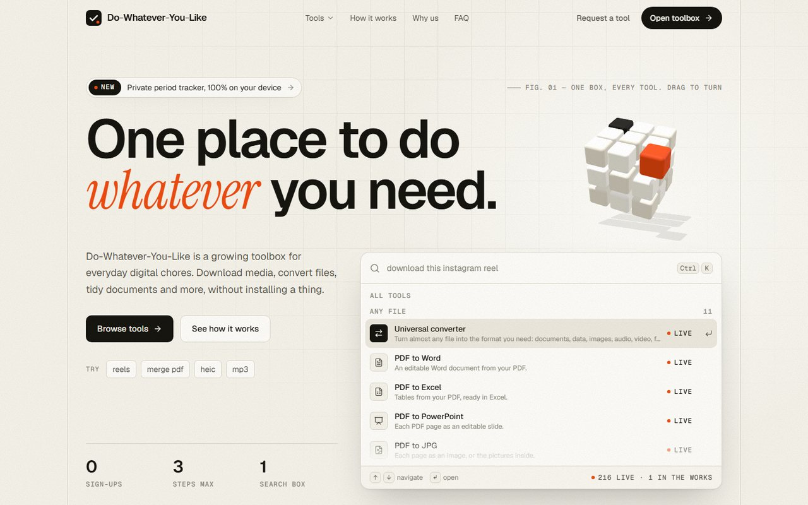</a>
</p>

---

## 📚 Contents

| Start here | Understand it | Build with it |
| :--- | :--- | :--- |
| [👋 What is it](#-what-is-do-whatever-you-like) | [🧭 Vision and principles](#-vision-aspiration-and-principles) | [🧱 How it works](#-how-it-works) |
| [🗂️ What's inside](#️-whats-inside) | [🚀 Our pace](#-our-pace) | [🔒 Privacy and safety](#-privacy-and-safety) |
| [🎬 See it in action](#-see-it-in-action) | [🗺️ What's next](#️-whats-next) | [🛠️ Tech stack](#️-tech-stack) |
| [💻 Run it yourself](#-run-it-on-your-computer) | [☁️ Deploy for free](#️-deploy-it-for-free) | [🧪 Testing](#-testing) |
| [📡 API](#-api-reference) | [➕ Add a tool](#-adding-a-new-tool) | [🤝 Contributing](#-contributing) |

---

## 🗂️ What's inside

251 live tools in 9 collections. Click a name to open that collection on the site.

| | Collection | What you can do | Tools |
| :---: | :--- | :--- | :---: |
| 🔁 | [**Any file**](https://do-whatever-you-like.colddsam.com/tools/category/files) | Convert almost any file to any format, compress, merge, split and inspect or build archives | **12** |
| 📄 | [**PDF tools**](https://do-whatever-you-like.colddsam.com/tools/category/pdf) | Merge, split, compress, edit, sign, protect, OCR and compare PDFs | **23** |
| 🖼️ | [**Image tools**](https://do-whatever-you-like.colddsam.com/tools/category/images) | Compress, resize, crop, remove backgrounds, upscale, vectorise to SVG, frame mockups, blur faces, make memes and icons | **20** |
| 💻 | [**Developer tools**](https://do-whatever-you-like.colddsam.com/tools/category/developer) | Format, minify and validate code, convert JSON/CSV/YAML/XML/SQL/types, query SQLite & Parquet, hashes, JWT, UUID/ULID, regex, DNS and HTTP checks, cron | **114** |
| ✍️ | [**Text tools**](https://do-whatever-you-like.colddsam.com/tools/category/text) | Writing helper, translator (text, audio & video), WhatsApp chat analyzer, word counter, case & list tools, binary and hex, Morse code, summaries | **28** |
| 🎨 | [**Charts, fonts and colour**](https://do-whatever-you-like.colddsam.com/tools/category/design) | Animated charts, flowcharts, font checker and maker, colour picker & 50–950 scales, SVG optimizer, CSS Grid/Flexbox & UI generators | **14** |
| ⬇️ | [**Media downloads**](https://do-whatever-you-like.colddsam.com/tools/category/downloads) | Save public YouTube, Instagram and Facebook videos, or just their sound | **3** |
| 🎬 | [**Audio and video**](https://do-whatever-you-like.colddsam.com/tools/category/media) | Trim, remove noise, change volume, waveforms & spectrograms, record your screen, subtitles & caption translation, speech to text, GIFs | **10** |
| 🧰 | [**Everyday utilities**](https://do-whatever-you-like.colddsam.com/tools/category/utilities) | Private period tracker, EMI/SIP/GST calculators, bill splitter, invoice & signature maker, QR codes, converters, clocks, passwords, device tests | **27** |

<details>
<summary><b>📋 The full list of every tool</b> (click to open)</summary>
<br>

<details>
<summary><b>🔁 Any file</b> — 12 tools</summary>
<br>

- [**Universal converter**](https://do-whatever-you-like.colddsam.com/tools/convert-anything) — Turn almost any file into the format you need: documents, data, images, audio, video, fonts and more.
- [**PDF to Word**](https://do-whatever-you-like.colddsam.com/tools/pdf-to-word) — An editable Word document from your PDF.
- [**PDF to Excel**](https://do-whatever-you-like.colddsam.com/tools/pdf-to-excel) — Tables from your PDF, ready in Excel.
- [**PDF to PowerPoint**](https://do-whatever-you-like.colddsam.com/tools/pdf-to-powerpoint) — Each PDF page as an editable slide.
- [**PDF to JPG**](https://do-whatever-you-like.colddsam.com/tools/pdf-to-jpg) — Each page as an image, or the pictures inside.
- [**Word to PDF**](https://do-whatever-you-like.colddsam.com/tools/word-to-pdf) — Turn DOC and DOCX files into PDF.
- [**PowerPoint to PDF**](https://do-whatever-you-like.colddsam.com/tools/powerpoint-to-pdf) — Turn slides into a PDF, one page per slide.
- [**Excel to PDF**](https://do-whatever-you-like.colddsam.com/tools/excel-to-pdf) — Turn spreadsheets into PDF.
- [**Compress files**](https://do-whatever-you-like.colddsam.com/tools/compress-files) — Make any file smaller: PDF, Word, PowerPoint, Excel, photos, audio, video and more.
- [**ZIP, TAR & GZ archive tool**](https://do-whatever-you-like.colddsam.com/tools/archive-extractor-creator) — Inspect archive contents, preview files inside or bundle multiple files into .zip, .tar, .tar.gz or .gz in your browser.
- [**Merge files**](https://do-whatever-you-like.colddsam.com/tools/merge-files) — Combine Word, PowerPoint, Excel, CSV, PDF, audio or video files into one.
- [**Split files**](https://do-whatever-you-like.colddsam.com/tools/split-files) — Break Word, PowerPoint, Excel, CSV, PDF, audio or video into parts.

</details>

<details>
<summary><b>📄 PDF tools</b> — 23 tools</summary>
<br>

- [**PDF toolkit**](https://do-whatever-you-like.colddsam.com/tools/pdf) — Merge, split, rearrange and compress PDFs in seconds.
- [**Merge PDF**](https://do-whatever-you-like.colddsam.com/tools/merge-pdf) — Combine PDFs into one, in the order you set.
- [**Split PDF**](https://do-whatever-you-like.colddsam.com/tools/split-pdf) — Break a PDF into parts, or group pages your way.
- [**Remove pages**](https://do-whatever-you-like.colddsam.com/tools/remove-pages) — Delete the pages you don't need.
- [**Extract pages**](https://do-whatever-you-like.colddsam.com/tools/extract-pages) — Keep just the pages you pick, as a new PDF.
- [**Organize PDF**](https://do-whatever-you-like.colddsam.com/tools/organize-pdf) — Reorder, turn and remove pages, seeing each one.
- [**Scan to PDF**](https://do-whatever-you-like.colddsam.com/tools/scan-to-pdf) — A guided camera finds the page, straightens it and cleans it up: a crisp, searchable PDF.
- [**Compress PDF**](https://do-whatever-you-like.colddsam.com/tools/compress-pdf) — Make a PDF smaller, at the strength you choose.
- [**Repair PDF**](https://do-whatever-you-like.colddsam.com/tools/repair-pdf) — Recover the pages of a damaged PDF.
- [**OCR PDF**](https://do-whatever-you-like.colddsam.com/tools/ocr-pdf) — Make scanned PDFs searchable and selectable.
- [**PDF to PDF/A**](https://do-whatever-you-like.colddsam.com/tools/pdf-to-pdfa) — An archive-ready PDF for long-term storage.
- [**JPG to PDF**](https://do-whatever-you-like.colddsam.com/tools/jpg-to-pdf) — Turn photos and images into one PDF.
- [**HTML to PDF**](https://do-whatever-you-like.colddsam.com/tools/html-to-pdf) — Save any public web page as a PDF.
- [**Rotate PDF**](https://do-whatever-you-like.colddsam.com/tools/rotate-pdf) — Turn pages the right way up, one or all at once.
- [**Add page numbers**](https://do-whatever-you-like.colddsam.com/tools/page-numbers) — Number pages where you want, how you want.
- [**Add watermark**](https://do-whatever-you-like.colddsam.com/tools/watermark-pdf) — Stamp text or an image over your pages.
- [**Crop PDF**](https://do-whatever-you-like.colddsam.com/tools/crop-pdf) — Trim margins or cut pages down to an area.
- [**Edit PDF**](https://do-whatever-you-like.colddsam.com/tools/edit-pdf) — Add text, images, shapes and drawings.
- [**Unlock PDF**](https://do-whatever-you-like.colddsam.com/tools/unlock-pdf) — Remove a PDF's password and restrictions.
- [**Protect PDF**](https://do-whatever-you-like.colddsam.com/tools/protect-pdf) — Lock a PDF with a password.
- [**Sign PDF**](https://do-whatever-you-like.colddsam.com/tools/sign-pdf) — Draw, type or upload your signature and place it.
- [**Redact PDF**](https://do-whatever-you-like.colddsam.com/tools/redact-pdf) — Black out private details for good.
- [**Compare PDF**](https://do-whatever-you-like.colddsam.com/tools/compare-pdf) — See exactly what changed between two versions.

</details>

<details>
<summary><b>🖼️ Image tools</b> — 20 tools</summary>
<br>

- [**Image studio**](https://do-whatever-you-like.colddsam.com/tools/image) — Compress, resize, convert and cut out images in seconds.
- [**Compress image**](https://do-whatever-you-like.colddsam.com/tools/compress-image) — Make JPG, PNG, GIF, WebP and SVG files smaller.
- [**Upscale image**](https://do-whatever-you-like.colddsam.com/tools/upscale-image) — Enlarge a picture 2× or 4× with AI that redraws the detail.
- [**Remove background**](https://do-whatever-you-like.colddsam.com/tools/remove-background) — Cut out the subject: transparent, a colour, or a soft blur behind.
- [**Meme generator**](https://do-whatever-you-like.colddsam.com/tools/meme-generator) — Captions on a picture, the classic way, in seconds.
- [**Photo editor**](https://do-whatever-you-like.colddsam.com/tools/photo-editor) — Filters, light and colour, text, stickers and frames.
- [**Emoji to image**](https://do-whatever-you-like.colddsam.com/tools/emoji-to-image) — Any emoji as a PNG, WebP or SVG, in four styles and any size.
- [**Pixelate image**](https://do-whatever-you-like.colddsam.com/tools/pixelate-image) — Turn a picture into pixel art, or pixelate just a part of it.
- [**Change GIF speed**](https://do-whatever-you-like.colddsam.com/tools/gif-speed) — Speed up or slow down an animated GIF, reverse it or make a boomerang.
- [**Resize image**](https://do-whatever-you-like.colddsam.com/tools/resize-image) — Set an exact size in pixels, or scale by percentage.
- [**Crop image**](https://do-whatever-you-like.colddsam.com/tools/crop-image) — Drag a box on the picture, or type exact pixels.
- [**Rotate image**](https://do-whatever-you-like.colddsam.com/tools/rotate-image) — Turn or flip many images at once, or each on its own.
- [**Convert to JPG**](https://do-whatever-you-like.colddsam.com/tools/convert-to-jpg) — HEIC, PNG, WebP, TIFF, PSD, SVG, RAW and more, to JPG.
- [**Convert from JPG**](https://do-whatever-you-like.colddsam.com/tools/jpg-to-image) — JPG to PNG, WebP or GIF, or several into an animated GIF.
- [**HTML to image**](https://do-whatever-you-like.colddsam.com/tools/html-to-image) — Capture a web page, or HTML you paste, as a picture.
- [**Icon maker**](https://do-whatever-you-like.colddsam.com/tools/icon-maker) — Favicons and app icons for websites, Windows, macOS, iOS and Android, from one picture.
- [**Watermark image**](https://do-whatever-you-like.colddsam.com/tools/watermark-image) — Stamp text or a logo, placed, faded, turned or tiled.
- [**Blur face**](https://do-whatever-you-like.colddsam.com/tools/blur-face) — Find faces and hide them, plus anything else you mark.
- [**Image to SVG vectoriser**](https://do-whatever-you-like.colddsam.com/tools/image-to-svg) — Trace PNG or JPG logos, sketches and icons into crisp scalable SVG vectors in your browser.
- [**Mockup & safe-zone frame**](https://do-whatever-you-like.colddsam.com/tools/mockup-frame-generator) — Frame screenshots inside browser windows or phones, or preview YouTube/Reels/TikTok safe zones.

</details>

<details>
<summary><b>💻 Developer tools</b> — 114 tools</summary>
<br>

[Developer utilities](https://do-whatever-you-like.colddsam.com/tools/dev) · [JSON formatter & validator](https://do-whatever-you-like.colddsam.com/tools/json-formatter) · [JWT decoder](https://do-whatever-you-like.colddsam.com/tools/jwt-decoder) · [Base64 encode & decode](https://do-whatever-you-like.colddsam.com/tools/base64-encoder) · [Regex tester](https://do-whatever-you-like.colddsam.com/tools/regex-tester) · [Unix timestamp converter](https://do-whatever-you-like.colddsam.com/tools/timestamp-converter) · [Diff checker](https://do-whatever-you-like.colddsam.com/tools/diff-checker) · [UUID, ULID & NanoID generator](https://do-whatever-you-like.colddsam.com/tools/uuid-generator) · [URL encoder & query parser](https://do-whatever-you-like.colddsam.com/tools/url-encoder) · [HTML formatter](https://do-whatever-you-like.colddsam.com/tools/html-formatter) · [CSS formatter](https://do-whatever-you-like.colddsam.com/tools/css-formatter) · [JavaScript formatter](https://do-whatever-you-like.colddsam.com/tools/javascript-formatter) · [TypeScript formatter](https://do-whatever-you-like.colddsam.com/tools/typescript-formatter) · [React (JSX) formatter](https://do-whatever-you-like.colddsam.com/tools/react-formatter) · [Angular template formatter](https://do-whatever-you-like.colddsam.com/tools/angular-formatter) · [XML formatter](https://do-whatever-you-like.colddsam.com/tools/xml-formatter) · [PHP formatter](https://do-whatever-you-like.colddsam.com/tools/php-formatter) · [Java formatter](https://do-whatever-you-like.colddsam.com/tools/java-formatter) · [SQL formatter](https://do-whatever-you-like.colddsam.com/tools/sql-formatter) · [YAML formatter](https://do-whatever-you-like.colddsam.com/tools/yaml-formatter) · [Markdown formatter](https://do-whatever-you-like.colddsam.com/tools/markdown-formatter) · [HTML minifier](https://do-whatever-you-like.colddsam.com/tools/html-minifier) · [CSS minifier](https://do-whatever-you-like.colddsam.com/tools/css-minifier) · [JavaScript minifier](https://do-whatever-you-like.colddsam.com/tools/javascript-minifier) · [JavaScript validator](https://do-whatever-you-like.colddsam.com/tools/javascript-validator) · [CSS validator](https://do-whatever-you-like.colddsam.com/tools/css-validator) · [XML validator](https://do-whatever-you-like.colddsam.com/tools/xml-validator) · [YAML validator](https://do-whatever-you-like.colddsam.com/tools/yaml-validator) · [Card number validator](https://do-whatever-you-like.colddsam.com/tools/card-validator) · [XSD validator](https://do-whatever-you-like.colddsam.com/tools/xsd-validator) · [Code editor](https://do-whatever-you-like.colddsam.com/tools/code-editor) · [Online text editor](https://do-whatever-you-like.colddsam.com/tools/text-editor) · [Markdown editor](https://do-whatever-you-like.colddsam.com/tools/markdown-editor) · [Markdown viewer](https://do-whatever-you-like.colddsam.com/tools/markdown-viewer) · [HTML viewer](https://do-whatever-you-like.colddsam.com/tools/html-viewer) · [XML viewer](https://do-whatever-you-like.colddsam.com/tools/xml-viewer) · [XPath tester](https://do-whatever-you-like.colddsam.com/tools/xpath-tester) · [XSLT transformer](https://do-whatever-you-like.colddsam.com/tools/xslt-transformer) · [JSONPath tester](https://do-whatever-you-like.colddsam.com/tools/jsonpath-tester) · [URI template expander](https://do-whatever-you-like.colddsam.com/tools/uri-template) · [JSON escape / unescape](https://do-whatever-you-like.colddsam.com/tools/json-escape) · [HTML entities encoder](https://do-whatever-you-like.colddsam.com/tools/html-entities) · [IEEE-754 float analyser](https://do-whatever-you-like.colddsam.com/tools/ieee-754) · [MD5 hash generator](https://do-whatever-you-like.colddsam.com/tools/md5-hash) · [SHA-1 hash generator](https://do-whatever-you-like.colddsam.com/tools/sha1-hash) · [SHA-224 hash generator](https://do-whatever-you-like.colddsam.com/tools/sha224-hash) · [SHA-256 hash generator](https://do-whatever-you-like.colddsam.com/tools/sha256-hash) · [SHA-384 hash generator](https://do-whatever-you-like.colddsam.com/tools/sha384-hash) · [SHA-512 hash generator](https://do-whatever-you-like.colddsam.com/tools/sha512-hash) · [SHA-512/224 hash generator](https://do-whatever-you-like.colddsam.com/tools/sha512-224-hash) · [SHA-512/256 hash generator](https://do-whatever-you-like.colddsam.com/tools/sha512-256-hash) · [SHA3-224 hash generator](https://do-whatever-you-like.colddsam.com/tools/sha3-224-hash) · [SHA3-256 hash generator](https://do-whatever-you-like.colddsam.com/tools/sha3-256-hash) · [SHA3-384 hash generator](https://do-whatever-you-like.colddsam.com/tools/sha3-384-hash) · [SHA3-512 hash generator](https://do-whatever-you-like.colddsam.com/tools/sha3-512-hash) · [SHAKE-128 hash generator](https://do-whatever-you-like.colddsam.com/tools/shake128-hash) · [SHAKE-256 hash generator](https://do-whatever-you-like.colddsam.com/tools/shake256-hash) · [MD2 hash generator](https://do-whatever-you-like.colddsam.com/tools/md2-hash) · [MD4 hash generator](https://do-whatever-you-like.colddsam.com/tools/md4-hash) · [NTLM hash generator](https://do-whatever-you-like.colddsam.com/tools/ntlm-hash) · [CRC-16 checksum](https://do-whatever-you-like.colddsam.com/tools/crc16-hash) · [CRC-32 checksum](https://do-whatever-you-like.colddsam.com/tools/crc32-hash) · [HMAC generator](https://do-whatever-you-like.colddsam.com/tools/hmac-generator) · [WordPress password hash](https://do-whatever-you-like.colddsam.com/tools/wordpress-hash) · [Random name picker](https://do-whatever-you-like.colddsam.com/tools/random-name-picker) · [Random string generator](https://do-whatever-you-like.colddsam.com/tools/random-string) · [Random alphanumeric](https://do-whatever-you-like.colddsam.com/tools/random-alphanumeric) · [Random letter generator](https://do-whatever-you-like.colddsam.com/tools/random-letters) · [Random number generator](https://do-whatever-you-like.colddsam.com/tools/random-integer) · [Random decimal generator](https://do-whatever-you-like.colddsam.com/tools/random-decimal) · [Random fraction generator](https://do-whatever-you-like.colddsam.com/tools/random-fraction) · [Random prime generator](https://do-whatever-you-like.colddsam.com/tools/random-prime) · [Random hex generator](https://do-whatever-you-like.colddsam.com/tools/random-hex) · [Random binary generator](https://do-whatever-you-like.colddsam.com/tools/random-binary) · [Random byte generator](https://do-whatever-you-like.colddsam.com/tools/random-bytes) · [Random date generator](https://do-whatever-you-like.colddsam.com/tools/random-date) · [Random time generator](https://do-whatever-you-like.colddsam.com/tools/random-time) · [Random IP address generator](https://do-whatever-you-like.colddsam.com/tools/random-ip) · [MAC address generator](https://do-whatever-you-like.colddsam.com/tools/random-mac) · [Random JSON generator](https://do-whatever-you-like.colddsam.com/tools/random-json) · [Random CSV generator](https://do-whatever-you-like.colddsam.com/tools/random-csv) · [Random TSV generator](https://do-whatever-you-like.colddsam.com/tools/random-tsv) · [Random XML generator](https://do-whatever-you-like.colddsam.com/tools/random-xml) · [Random data from regex](https://do-whatever-you-like.colddsam.com/tools/random-from-regex) · [Random bitmap generator](https://do-whatever-you-like.colddsam.com/tools/random-bitmap) · [DNS lookup](https://do-whatever-you-like.colddsam.com/tools/dns-lookup) · [MX lookup](https://do-whatever-you-like.colddsam.com/tools/mx-lookup) · [NS lookup](https://do-whatever-you-like.colddsam.com/tools/ns-lookup) · [Website to IP](https://do-whatever-you-like.colddsam.com/tools/website-to-ip) · [IP to hostname](https://do-whatever-you-like.colddsam.com/tools/ip-to-hostname) · [HTTP header checker](https://do-whatever-you-like.colddsam.com/tools/http-headers) · [HTTP status checker](https://do-whatever-you-like.colddsam.com/tools/http-status) · [Open port checker](https://do-whatever-you-like.colddsam.com/tools/open-port-checker) · [API tester](https://do-whatever-you-like.colddsam.com/tools/api-tester) · [HTML link generator](https://do-whatever-you-like.colddsam.com/tools/html-link-generator) · [HTML table generator](https://do-whatever-you-like.colddsam.com/tools/html-table-generator) · [Redirect generator](https://do-whatever-you-like.colddsam.com/tools/redirect-generator) · [Share link generator](https://do-whatever-you-like.colddsam.com/tools/share-link-generator) · [REM to PX converter](https://do-whatever-you-like.colddsam.com/tools/rem-px-converter) · [CSS to Less](https://do-whatever-you-like.colddsam.com/tools/css-to-less) · [ASCII table](https://do-whatever-you-like.colddsam.com/tools/ascii-table) · [Data format converter](https://do-whatever-you-like.colddsam.com/tools/data-format-converter) · [JSON to CSV converter](https://do-whatever-you-like.colddsam.com/tools/json-to-csv) · [CSV to JSON converter](https://do-whatever-you-like.colddsam.com/tools/csv-to-json) · [JSON to YAML converter](https://do-whatever-you-like.colddsam.com/tools/json-to-yaml) · [YAML to JSON converter](https://do-whatever-you-like.colddsam.com/tools/yaml-to-json) · [JSON to XML converter](https://do-whatever-you-like.colddsam.com/tools/json-to-xml) · [XML to JSON converter](https://do-whatever-you-like.colddsam.com/tools/xml-to-json) · [HTML to Markdown converter](https://do-whatever-you-like.colddsam.com/tools/html-to-markdown) · [Markdown to HTML converter](https://do-whatever-you-like.colddsam.com/tools/markdown-to-html) · [JSON / SQL to code types](https://do-whatever-you-like.colddsam.com/tools/json-sql-to-types) · [Chmod permissions calculator](https://do-whatever-you-like.colddsam.com/tools/chmod-calculator) · [SQLite, CSV & Parquet viewer](https://do-whatever-you-like.colddsam.com/tools/sqlite-csv-parquet-viewer) · [Cron expression explainer](https://do-whatever-you-like.colddsam.com/tools/cron-explainer)

</details>

<details>
<summary><b>✍️ Text tools</b> — 28 tools</summary>
<br>

- [**Writing helper**](https://do-whatever-you-like.colddsam.com/tools/writing) — Summarise long passages, rewrite tone and fix grammar right in your browser.
- [**Translator**](https://do-whatever-you-like.colddsam.com/tools/translator) — Translate plain text, subtitles (`.srt`/`.vtt`), audio recordings, voice notes or videos — returning dubbed audio/video files plus copyable input and translated transcripts.
- [**WhatsApp chat analyzer**](https://do-whatever-you-like.colddsam.com/tools/whatsapp-chat-analyzer) — Turn any exported WhatsApp chat into stats, timelines, activity heatmaps, reply speed, top emojis and searchable messages — in your browser.
- [**Text to binary**](https://do-whatever-you-like.colddsam.com/tools/text-to-binary) — Turn text into binary code, eight bits per byte.
- [**Binary to text**](https://do-whatever-you-like.colddsam.com/tools/binary-to-text) — Read binary code back as text (binary translator).
- [**Text to hex**](https://do-whatever-you-like.colddsam.com/tools/text-to-hex) — Text as hexadecimal byte values.
- [**Hex to text**](https://do-whatever-you-like.colddsam.com/tools/hex-to-text) — Hexadecimal bytes back to readable text.
- [**Text to ASCII codes**](https://do-whatever-you-like.colddsam.com/tools/text-to-ascii) — Each character's ASCII (decimal) code.
- [**ASCII codes to text**](https://do-whatever-you-like.colddsam.com/tools/ascii-to-text) — Decimal ASCII or Unicode codes back to characters.
- [**Number to words**](https://do-whatever-you-like.colddsam.com/tools/number-to-words) — Spell out any number, with lakh and crore if you like.
- [**Words to number**](https://do-whatever-you-like.colddsam.com/tools/words-to-number) — “Two thousand and five” becomes 2005.
- [**Roman numeral converter**](https://do-whatever-you-like.colddsam.com/tools/roman-numerals) — Numbers to Roman numerals and back, 1 to 3999.
- [**Morse code translator**](https://do-whatever-you-like.colddsam.com/tools/morse-code) — Text to Morse and back, with sound you can play.
- [**Morse code audio decoder**](https://do-whatever-you-like.colddsam.com/tools/morse-audio-decoder) — Turn Morse beeps from a recording, a video or your microphone into text.
- [**Upside-down text**](https://do-whatever-you-like.colddsam.com/tools/upside-down-text) — Flip text upside down for posts and bios.
- [**Mirror text**](https://do-whatever-you-like.colddsam.com/tools/mirror-text) — Text as its mirror image.
- [**Reverse text**](https://do-whatever-you-like.colddsam.com/tools/reverse-text) — Reverse the letters, the words, each word or the lines.
- [**Text repeater**](https://do-whatever-you-like.colddsam.com/tools/text-repeater) — Repeat text any number of times, with a separator.
- [**Find and replace**](https://do-whatever-you-like.colddsam.com/tools/find-and-replace) — Find words or patterns in text, see every match, and replace them.
- [**Split text**](https://do-whatever-you-like.colddsam.com/tools/split-text) — Split text by lines, commas, words, a pattern or a length.
- [**Sort and shuffle lines**](https://do-whatever-you-like.colddsam.com/tools/line-tools) — Shuffle, sort, de-duplicate, number or trim lines.
- [**Lorem ipsum generator**](https://do-whatever-you-like.colddsam.com/tools/lorem-ipsum) — Placeholder text by paragraphs, sentences or words.
- [**Text to image**](https://do-whatever-you-like.colddsam.com/tools/text-to-image) — Turn text into a PNG, with font, colours and padding.
- [**Text summarizer**](https://do-whatever-you-like.colddsam.com/tools/text-summarizer) — The key sentences of a long text, in your browser.
- [**Word, character & reading time counter**](https://do-whatever-you-like.colddsam.com/tools/word-counter) — Live word, character, sentence, paragraph counts, reading time and Flesch score.
- [**Case converter**](https://do-whatever-you-like.colddsam.com/tools/case-converter) — Convert text across camelCase, snake_case, kebab-case, PascalCase, Title Case and more.
- [**List comparator (set operations)**](https://do-whatever-you-like.colddsam.com/tools/list-comparator) — Compare two lists to find A only, B only, intersection, union and symmetric difference.
- [**Invisible character & smart quote cleaner**](https://do-whatever-you-like.colddsam.com/tools/invisible-character-cleaner) — Inspect and strip zero-width spaces, non-breaking spaces, soft hyphens and curly quotes.

</details>

<details>
<summary><b>🎨 Charts, fonts and colour</b> — 14 tools</summary>
<br>

- [**Chart maker**](https://do-whatever-you-like.colddsam.com/tools/chart-maker) — Make 30 kinds of charts from your own data, animate them, and save them as pictures, GIFs, videos or web pages.
- [**Flowchart maker**](https://do-whatever-you-like.colddsam.com/tools/flowchart-maker) — Draw flowcharts and diagrams by dragging shapes or typing text, with animated links and a play-through.
- [**Font checker**](https://do-whatever-you-like.colddsam.com/tools/font-checker) — See, test and validate any font, or find the fonts inside a PDF or Office file.
- [**Font creator**](https://do-whatever-you-like.colddsam.com/tools/font-creator) — Make your own font: draw letters, build a pixel font, or turn your handwriting into a font.
- [**Colour picker**](https://do-whatever-you-like.colddsam.com/tools/color-picker) — Pick colours from any image, PDF, slide deck, document or video, and export the palette.
- [**Contrast checker**](https://do-whatever-you-like.colddsam.com/tools/contrast-checker) — Check any text and background colours against WCAG AA and AAA, with fixes.
- [**CSS gradient generator**](https://do-whatever-you-like.colddsam.com/tools/css-gradient-generator) — Linear, radial and conic gradients with any number of colours.
- [**Box shadow generator**](https://do-whatever-you-like.colddsam.com/tools/box-shadow-generator) — Layered, soft or crisp CSS shadows, live.
- [**Border radius generator**](https://do-whatever-you-like.colddsam.com/tools/border-radius-generator) — Rounded corners, one by one, or organic blob shapes.
- [**Glassmorphism CSS generator**](https://do-whatever-you-like.colddsam.com/tools/glassmorphism-generator) — Frosted glass cards with backdrop blur, translucency, saturation and crisp borders.
- [**Neumorphism CSS generator**](https://do-whatever-you-like.colddsam.com/tools/neumorphism-generator) — Soft extruded UI surfaces with directional highlights and soft shadows.
- [**SVG optimizer & JSX converter**](https://do-whatever-you-like.colddsam.com/tools/svg-optimizer-jsx) — Minify raw SVG paths, strip bloat and convert attributes for React JSX/TSX or CSS Data URIs.
- [**CSS Grid & Flexbox playground**](https://do-whatever-you-like.colddsam.com/tools/css-grid-flexbox-playground) — Visual layout builder with live cells that outputs Tailwind classes, CSS and HTML.
- [**Color palette & 50–950 scale generator**](https://do-whatever-you-like.colddsam.com/tools/color-palette-scale-generator) — Generate full Tailwind 50–950 colour scales, WCAG badges and harmonious palettes from one hex colour.

</details>

<details>
<summary><b>⬇️ Media downloads</b> — 3 tools</summary>
<br>

- [**YouTube downloader**](https://do-whatever-you-like.colddsam.com/tools/youtube) — Save videos and Shorts in the quality you pick, or just the audio as MP3 or M4A.
- [**Instagram downloader**](https://do-whatever-you-like.colddsam.com/tools/instagram) — Reels, posts and carousels, or just a reel's audio, straight from a link.
- [**Facebook downloader**](https://do-whatever-you-like.colddsam.com/tools/facebook) — Grab public videos and reels, or just their audio, without the hassle.

</details>

<details>
<summary><b>🎬 Audio and video</b> — 10 tools</summary>
<br>

- [**Video to frames**](https://do-whatever-you-like.colddsam.com/tools/video-to-frames) — Split a video into still frames: pick how many, which part and the format.
- [**Video to GIF**](https://do-whatever-you-like.colddsam.com/tools/video-to-gif) — Turn a clip into a GIF: trim it, set the size, smoothness, speed and loop.
- [**Video & audio trimmer**](https://do-whatever-you-like.colddsam.com/tools/trim-media) — Cut a video or song to the part you want: fast and lossless, or frame-exact.
- [**Noise remover**](https://do-whatever-you-like.colddsam.com/tools/noise-remover) — Remove background noise, hiss, hum and clicks from audio or a video's sound.
- [**Volume booster & normaliser**](https://do-whatever-you-like.colddsam.com/tools/audio-volume) — Make audio or a video louder or quieter, even out the loudness, or mute a video.
- [**Screen & voice recorder**](https://do-whatever-you-like.colddsam.com/tools/screen-recorder) — Record your screen, a window or a tab with your voice, or just your voice.
- [**Subtitle editor**](https://do-whatever-you-like.colddsam.com/tools/subtitle-editor) — Fix subtitle timing and text, sync them to a video, translate captions with one click while keeping cue timestamps, and save as SRT or VTT.
- [**Audio waveform & spectrogram**](https://do-whatever-you-like.colddsam.com/tools/audio-waveform-generator) — Turn any audio clip into a downloadable SVG/PNG waveform or STFT frequency spectrogram.
- [**Video to MP3**](https://do-whatever-you-like.colddsam.com/tools/audio) — Pull a clean MP3 out of any video file.
- [**Audio to text**](https://do-whatever-you-like.colddsam.com/tools/audio-to-text) — Turn speech into text you can edit, copy, export as SRT/VTT, or translate right inline.

</details>

<details>
<summary><b>🧰 Everyday utilities</b> — 27 tools</summary>
<br>

- [**Period tracker**](https://do-whatever-you-like.colddsam.com/tools/period-tracker) — Track your period, see when the next one is due, and log symptoms and moods. Private: it never leaves your phone.
- [**QR generator**](https://do-whatever-you-like.colddsam.com/tools/qr) — Turn links, Wi-Fi, contacts and more into a crisp QR code.
- [**Scientific calculator**](https://do-whatever-you-like.colddsam.com/tools/scientific-calculator) — Trig, logs, powers, factorials, memory and history, with units too.
- [**Screen resolution**](https://do-whatever-you-like.colddsam.com/tools/screen-resolution) — Your screen's resolution, pixel ratio and colour depth.
- [**Browser window size**](https://do-whatever-you-like.colddsam.com/tools/browser-window-size) — The browser's viewport size, live as you resize.
- [**Responsive tester**](https://do-whatever-you-like.colddsam.com/tools/screen-resolution-tester) — See a website in 30+ real device frames, or at any custom size.
- [**Webcam test**](https://do-whatever-you-like.colddsam.com/tools/webcam-test) — Check your camera works, and see its resolution and frame rate.
- [**Pixel ruler**](https://do-whatever-you-like.colddsam.com/tools/pixel-ruler) — Measure anything on screen in pixels.
- [**What is my IP**](https://do-whatever-you-like.colddsam.com/tools/my-ip) — Your public IP address and what it says about your connection.
- [**Mic & speaker test**](https://do-whatever-you-like.colddsam.com/tools/mic-speaker-test) — Check your microphone with a live level meter, and your speakers left and right.
- [**Dead pixel test**](https://do-whatever-you-like.colddsam.com/tools/dead-pixel-test) — Full-screen colours to spot dead or stuck pixels, and a flasher to try to fix them.
- [**Unit converter**](https://do-whatever-you-like.colddsam.com/tools/unit-converter) — Length, weight, temperature, area, volume, speed, data and more, all at once.
- [**Currency converter**](https://do-whatever-you-like.colddsam.com/tools/currency-converter) — 30 currencies at today's European Central Bank rates.
- [**World clock & time zones**](https://do-whatever-you-like.colddsam.com/tools/world-clock) — The time in any city, and a meeting planner across time zones.
- [**Pomodoro timer**](https://do-whatever-you-like.colddsam.com/tools/pomodoro-timer) — Focus in 25-minute rounds with breaks, chimes and the time in your tab.
- [**Stopwatch & countdown**](https://do-whatever-you-like.colddsam.com/tools/stopwatch) — A stopwatch with laps, and a countdown timer with an alarm.
- [**Age calculator**](https://do-whatever-you-like.colddsam.com/tools/age-calculator) — Your exact age in years, months and days, and your next birthday.
- [**Date calculator**](https://do-whatever-you-like.colddsam.com/tools/date-calculator) — Days between two dates, business days, or a date plus or minus any time.
- [**Password generator & checker**](https://do-whatever-you-like.colddsam.com/tools/password-generator) — Strong passwords and memorable passphrases, and an honest strength check.
- [**Encrypt a note**](https://do-whatever-you-like.colddsam.com/tools/encrypt-note) — Lock a message with a password (AES-256), and share it as text or a link.
- [**Photo metadata viewer & remover**](https://do-whatever-you-like.colddsam.com/tools/exif-remover) — See the hidden GPS, camera and date in photos, and remove it without losing quality.
- [**QR code scanner**](https://do-whatever-you-like.colddsam.com/tools/qr-scanner) — Read a QR code from a picture, a screenshot or your camera.
- [**EMI & Compound Interest calculator**](https://do-whatever-you-like.colddsam.com/tools/emi-sip-calculator) — Calculate loan EMIs with prepayments, SIP growth and compound interest with INR schedules.
- [**SIP & Step-Up Wealth calculator**](https://do-whatever-you-like.colddsam.com/tools/sip-calculator) — Estimate mutual fund SIP returns with annual step-up and inflation adjustment.
- [**GST & Discount calculator**](https://do-whatever-you-like.colddsam.com/tools/gst-percentage-calculator) — Inclusive and exclusive Indian GST (CGST+SGST or IGST), coupon discounts and percentage math.
- [**Trip & Bill splitter**](https://do-whatever-you-like.colddsam.com/tools/bill-splitter) — Settle group trip expenses with minimum transfers or split dinner bills for WhatsApp.
- [**Invoice & Signature generator**](https://do-whatever-you-like.colddsam.com/tools/invoice-signature-generator) — Build GST-ready A4 printable invoices and draw transparent-background PNG signatures.

</details>

</details>

---

## 🎬 See it in action

<table>
<tr>
<td width="50%" valign="top">

**📊 Chart maker**: your data, 30 chart types, animated.

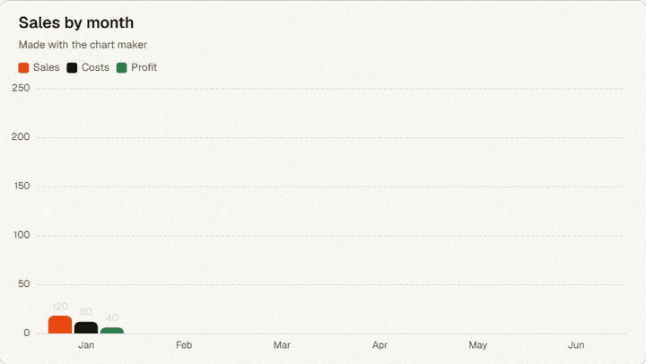

<sub>This GIF was exported by the chart maker itself.</sub>

</td>
<td width="50%" valign="top">

**🔀 Flowchart maker**: drag, connect, and press <i>Play the flow</i>.

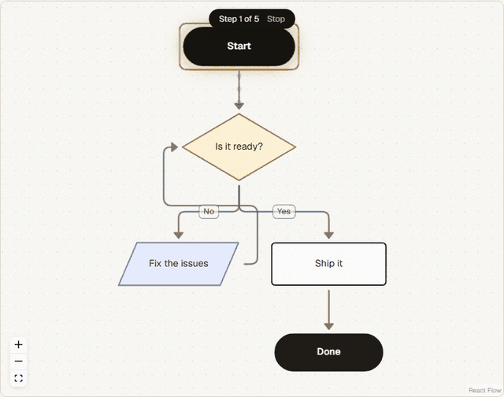

<sub>Moving-dot links and the step-by-step play mode.</sub>

</td>
</tr>
<tr>
<td colspan="2" valign="top">

**🌐 Translator (Text, Audio & Video)**: translate text, subtitles, voice recordings, and videos free — with dubbed media outputs plus copyable input and translated text.

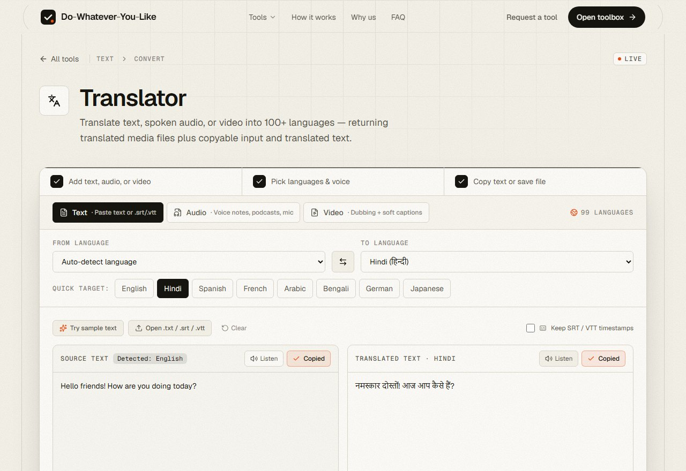

- **Text & subtitles**: Auto-detect language, preserve `.srt` / `.vtt` cue timestamps, listen aloud, or chain output straight back to source.
- **Audio & video dubbing**: Whisper transcription + multi-engine translation + neural voiceover (female/male, synced or fluent timing, optional subtle background mix and soft captions), returning both the dubbed file and copyable transcripts.

</td>
</tr>
<tr>
<td width="50%" valign="top">

**💬 WhatsApp chat analyzer**: `.txt` & `.zip` exports in **any language**, analyzed 100% locally.

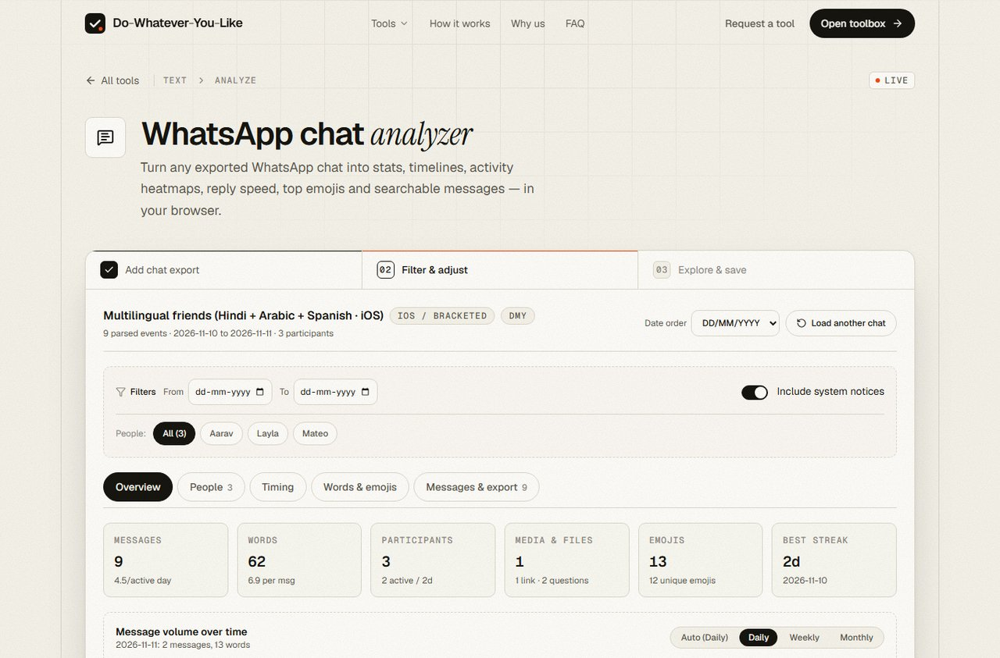

- Supports iOS, Android & Desktop exports in Latin, Hindi, Arabic RTL, CJK, Cyrillic & emojis.
- Timelines, 7×24 activity heatmaps, reply speed, starters, double-texts & searchable messages.
- Free and offline-capable in browser memory — export Excel CSV, JSON & HTML reports.

</td>
<td width="50%" valign="top">

**🌸 Period tracker**: one tap to log, predictions that learn your cycle, and it never leaves your phone.

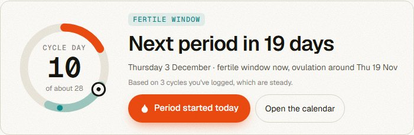

- Log periods, flow, symptoms, mood, pain & notes with cycle predictions.
- Private on-device storage with optional AES-256 PIN lock, backups & calendar reminders.
- General cycle insights, not medical advice or contraception.

</td>
</tr>
<tr>
<td width="50%" valign="top">

**🗂️ Every tool, one search away**

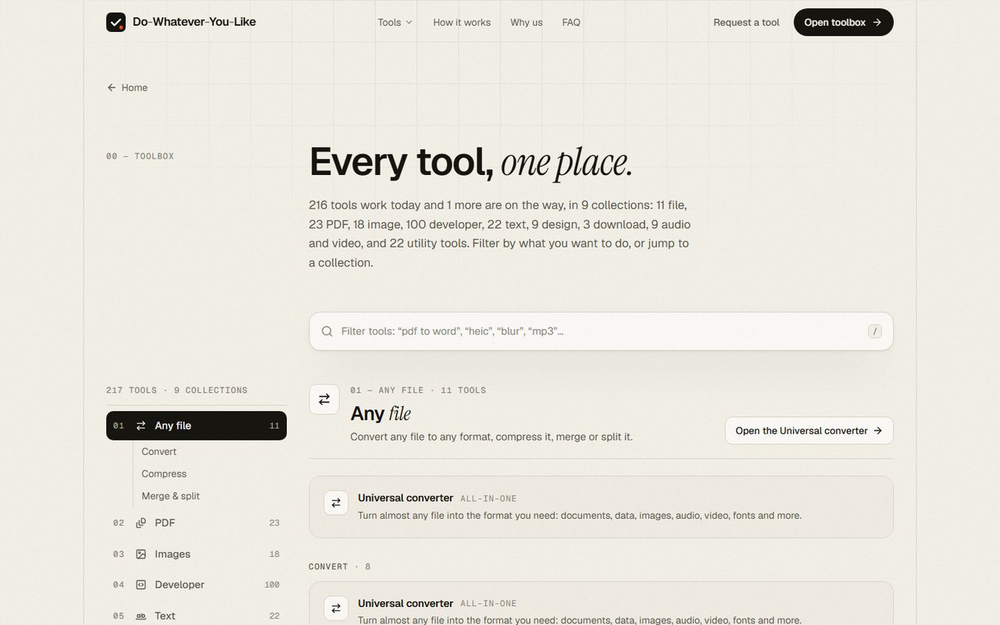

</td>
<td width="50%" valign="top">

**🧩 Each tool on its own page**, with steps, a spec sheet and a guide

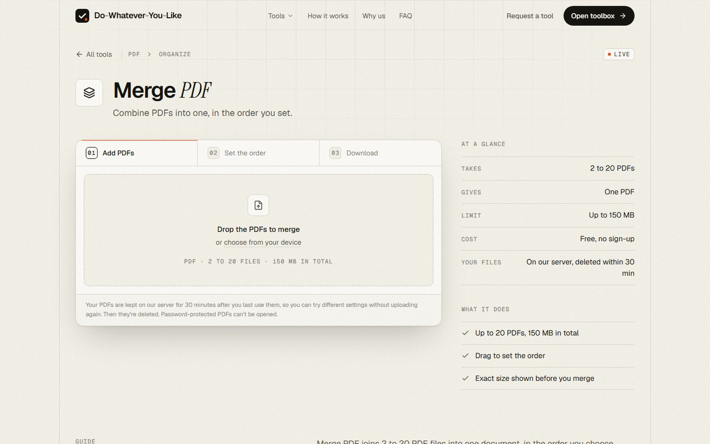

</td>
</tr>
</table>

---

## 🧭 Vision, aspiration and principles

> **Our vision:** one place where anyone can do any small digital job, for free, without signing up, and without worrying about where their files go.

**What we're aiming for**

- 🎯 **The first place you open.** When you need to convert, fix, shrink, check or make something, Do-Whatever-You-Like should already have the tool.
- 🏆 **As good as the paid app.** Each tool should do its one job well enough that you don't need a paid, single-purpose app for it.
- 🌍 **For every kind of person.** A student, a developer, a shop owner and a data analyst should all find what they need, explained in plain words.
- 📱 **Works anywhere.** Phone, tablet or desktop; fast on a slow connection.

**The rules we build by**

| Principle | What it means in practice |
| :--- | :--- |
| 💸 **Free, really** | No accounts, no limits behind a paywall, no watermarks. The whole thing runs on **free hosting tiers** (Vercel + Render), which proves it can stay free. |
| 🔒 **Private by default** | If a tool can run in your browser, it does. If it needs the server, the file lives in a private folder for that one request and is deleted right after. |
| 🧑‍🤝‍🧑 **Plain words** | Buttons say what they do ("Remove the noise", "Download 3 clean photos"). Errors say what went wrong and what to try. |
| 🛡️ **Safe by default** | Every uploaded file is checked by its real contents before anything opens it. A program renamed to `.pdf` is turned away. |
| 🎨 **One design** | Every page follows one design system (`frontend/DESIGN.md`), so all 251 tools feel like one product. |
| 🧩 **Built to grow** | One registry lists every tool; most new tools are one line plus one engine. That's how the site grew so fast. |

---

## 🚀 Our pace

Do-Whatever-You-Like went from an empty repository to **251 live tools in its first week**.

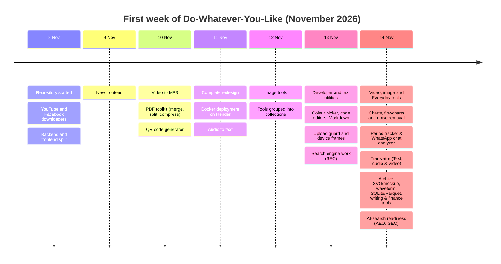

| 📅 Days | 🧰 Live tools | 🗂️ Collections | 📡 API endpoints | 🧪 Check scripts |
| :---: | :---: | :---: | :---: | :---: |
| 7 | 251 | 9 | 77 | 9 backend suites + browser & unit tests |

---

## 🗺️ What's next

- ✅ **Every listed tool is live.** All 251 tools in the directory — including the Writing helper — are now live and ready to use.
- 🙋 **Your requests.** The site has a *Request a tool* button. New tools are picked from what people ask for.
- 🔧 **Making the existing tools better**: faster on free hosting, clearer wording, and better phone layouts.

Have an idea? [Open an issue](https://github.com/colddsam/do-whatever-you-like/issues) or use *Request a tool* on the site.

---

## 🧱 How it works

The site has two parts: a **website** (Next.js, on Vercel) and a **processing server** (FastAPI, on Render). Many tools never touch the server at all.

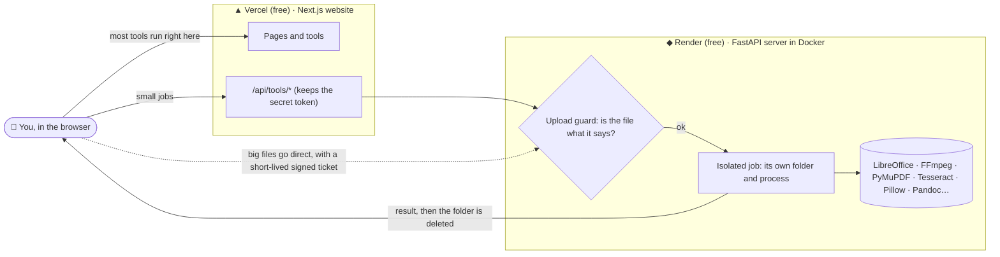

**What happens to a file you upload**

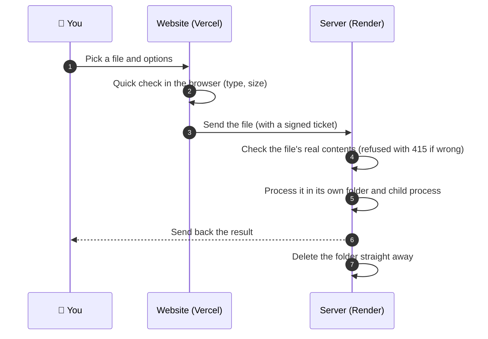

**Where each kind of tool runs**

| Runs in your browser (file never leaves your device) | Runs on our server (deleted after use) |
| :--- | :--- |
| Developer and text converters & analyzers, **SQLite/CSV/Parquet viewer**, **writing helper**, **WhatsApp chat analyzer**, **ZIP/TAR/GZ archive tool**, **image to SVG vectoriser**, **mockup & safe-zone frame**, **audio waveform & spectrogram**, chart maker, flowchart maker, SVG optimizer & CSS playgrounds, **period tracker**, EMI/SIP/GST calculators, bill splitter & invoice generator, QR scanner, photo metadata remover, password generator, encrypted notes, Markdown editor, video to GIF/frames, screen recorder, subtitle editor (with instant inline translation via API), Morse decoder, device tests and timers | PDF tools, universal converter, compress/merge/split, image AI (background removal, upscaling, face blur), audio to text, **translator (text, audio & video dubbing)**, media downloads, trim/volume/noise removal, font and colour inspection, DNS and HTTP checks |

---

## 🔒 Privacy and safety

| Promise | How it's kept |
| :--- | :--- |
| 🗑️ **Files are temporary** | Each server job gets its own folder, deleted right after the result is sent (multi-step PDF tools keep an upload for up to 30 minutes so you can try several options). |
| 🛡️ **Upload guard** | Every upload is checked by its real contents (magic numbers, Office file layout, text checks) **before** any program opens it. Programs are never accepted, whatever their name. |
| 🔑 **Secret token stays secret** | The browser never sees the server's token; the website adds it on its own server. Large uploads use short-lived signed tickets instead. |
| 🌐 **No snooping on your network** | Link tools only accept known hosts (YouTube, Instagram, Facebook), and network tools only reach public addresses, checked on every redirect. |
| 🧯 **One job can't break another** | Heavy jobs run in their own child process with a time limit, so a crash or a huge file can't take the server down. |
| 📏 **Size limits up front** | Oversized requests are refused before they're read (150 MB for files by default). |
| 🙈 **No accounts, no private content tracking** | Nothing you upload or parse is stored or sold. Aggregate traffic analytics use Vercel Web Analytics and Google Analytics 4 (`G-GVKMN99S3N`) when configured. |

---

## 🛠️ Tech stack

<table>
<tr><th align="left">Website</th><th align="left">Server</th></tr>
<tr>
<td valign="top">

- **Next.js 16** (App Router, Turbopack) and **React 19**
- **TypeScript 5**, **Tailwind CSS 4**, **motion**, **lenis**, **three**
- **ECharts 6** (charts), **React Flow 12** + **dagre** (flowcharts)
- **fflate** (in-browser ZIP handling), `Intl.Segmenter` (multilingual tokenization)
- **CodeMirror**, **Prettier**, **Terser**, **marked**, **KaTeX**, **Mermaid**
- **opentype.js**, **OpenCV.js**, **jsQR**, **exifr**, **mathjs**, **gifenc**
- Hosted on **Vercel** (free)

</td>
<td valign="top">

- **FastAPI** + **Uvicorn**, **Pydantic v2**, Python **3.13**
- **FFmpeg**, **LibreOffice**, **Pandoc**, **PyMuPDF**, **pdf2docx**
- **Tesseract** (OCR), **Ghostscript**, **Chromium** (web page to PDF)
- **Pillow**, **OpenCV**, **ONNX Runtime** (background removal, upscaling)
- **faster-whisper** or **Groq Whisper** (speech to text), **edge-tts** + **espeak-ng** & multi-engine free translation (dubbing & subtitles)
- **yt-dlp**, **instaloader**
- Shipped as a **Docker** image on **Render** (free plan)

</td>
</tr>
</table>

---

## 💻 Run it on your computer

**You need:** Python **3.11+**, Node.js **20+** and npm. On Windows, two scripts start and stop everything — `.\start-dev.ps1` automatically creates `backend\venv` + installs `requirements.txt` and runs `npm install` in `frontend` on first run if either is missing, then starts both servers.

```powershell
# 1. Get the code
git clone https://github.com/colddsam/do-whatever-you-like.git
cd do-whatever-you-like

# 2. Configure environment files
# create backend/.env with at least this line (see "Settings" below):
#   HEADER_TOKEN=any-long-random-secret
copy frontend\.env.example frontend\.env.local  # set BACKEND_TOKEN to the same value as HEADER_TOKEN

# 3. Start both (auto-installs backend venv + frontend node_modules if missing)
.\start-dev.ps1                       # stop with .\stop-dev.ps1
```

Prefer to install and start them manually (or on macOS/Linux)?

```bash
# Terminal 1: the server
cd backend
python -m venv venv
.\venv\Scripts\Activate.ps1          # macOS/Linux: source venv/bin/activate
pip install -r requirements.txt
python -m uvicorn app.main:app --host 127.0.0.1 --port 8000 --reload

# Terminal 2: the website
cd frontend
npm install
npm run dev
```

Then open **http://localhost:3000**.

<details>
<summary><b>⚙️ Settings (environment variables)</b></summary>
<br>

**Server: `backend/.env`**

| Name | What it's for | Default |
| :--- | :--- | :--- |
| `HEADER_TOKEN` | The secret the website uses to talk to the server. Make it long and random. | (required) |
| `ALLOWED_ORIGINS` | Website addresses allowed to call the server, as a JSON list. | `["http://localhost:3000"]` |
| `DEBUG` | `true` shows the interactive API docs at `/docs`. | `false` |
| `MAX_DOWNLOAD_SIZE_MB` | Largest file accepted or downloaded. | `150` |
| `MAX_VIDEO_DURATION_SECONDS` | Longest video the downloaders accept. | `3600` |
| `AUDIO_MP3_MAX_SECONDS` | Longest download that can be turned into MP3. | `1800` |
| `YOUTUBE_MAX_DOWNLOAD_MB` / `YOUTUBE_MAX_DURATION_SECONDS` / `YOUTUBE_MAX_HEIGHT` | YouTube limits; only qualities under the cap are offered. | `500` / `14400` / `1080` |
| `INSTAGRAM_COOKIE_FILE_PATH` | Signed-in session for Instagram (see [cookies](#-instagram-and-cookies)). | `cookies_instagram.txt` |
| `TRANSCRIBE_GROQ_API_KEY` | Optional free Groq key: fast, accurate speech to text. Without it, Whisper runs on the server. | (empty) |
| `MEDIA_EXACT_TRIM_MAX_SECONDS` / `MEDIA_VIDEO_REENCODE_MAX_SECONDS` | Caps for slow re-encoding jobs on a small server. | `180` / `1800` |
| `PDF_CACHE_TTL_SECONDS` | How long a PDF upload is kept for multi-step PDF tools. | `1800` |

Every tool has its own settings with a prefix (`PDF_`, `IMAGE_`, `UNIVERSAL_`, `COMPRESS_`, `MEDIA_`, `TRANSCRIBE_`…) in `backend/app/config/`. `render.yaml` shows the values tuned for the free plan.

**Website: `frontend/.env.local`**

| Name | What it's for |
| :--- | :--- |
| `BACKEND_URL` | Where the server is, e.g. `http://127.0.0.1:8000`. Server-side only. |
| `BACKEND_TOKEN` | Must equal `HEADER_TOKEN`. Never prefix it with `NEXT_PUBLIC_`. |
| `BACKEND_PUBLIC_URL` | Production only: the server's public address, so big files go straight there (Vercel caps requests at 4.5 MB). |
| `NEXT_PUBLIC_GA_ID` | Optional Google Analytics 4 measurement ID (`G-...`). Set as plain Config in Vercel. |
| `GOOGLE_SITE_VERIFICATION` / `BING_SITE_VERIFICATION` | Optional search-engine ownership tags. |

</details>

---

## ☁️ Deploy it for free

| Part | Where | How |
| :--- | :--- | :--- |
| 🖥️ **Website** | **Vercel** (Hobby, free) | Import the repo, set **Root directory** to `frontend`, add `BACKEND_URL`, `BACKEND_TOKEN` and `BACKEND_PUBLIC_URL`. |
| ⚙️ **Server** | **Render** (free web service) | *New → Blueprint* and pick this repo. `render.yaml` builds `backend/Dockerfile` with every engine included. Copy the generated `HEADER_TOKEN` to Vercel's `BACKEND_TOKEN`, and set `ALLOWED_ORIGINS` to your Vercel address. |

> **Good to know about free plans.** Render's free server has 512 MB of memory and a small slice of CPU, and it goes to sleep when nobody uses it, so the first request after a quiet spell can take a minute. That's why slow jobs (video re-encoding, OCR on huge PDFs) have caps in `render.yaml`, and why everything that can run in the browser does.

### 🍪 Instagram and cookies

Public YouTube and Facebook videos work without anything extra. **Instagram only shares posts with a signed-in session**, so the server needs a cookie file:

1. Use a **spare account**, never your personal one.
2. Log in from a private browser window and export cookies in **Netscape format** (for example with the *Get cookies.txt LOCALLY* extension).
3. Close the window **without logging out** (logging out ends the session).
4. Locally, save it as `backend/cookies_instagram.txt`. On Render, add it under **Environment → Secret Files** with the same name; `render.yaml` already points to `/etc/secrets/`.

Cookie files are git-ignored and never committed. Without one, the Instagram page simply says downloads aren't set up.

---

## 🧪 Testing

Everything new is checked end to end with real files before it ships.

| Check | Command | What it proves |
| :--- | :--- | :--- |
| Website types and style | `cd frontend && npx tsc --noEmit && npx eslint src` | The code compiles and follows the rules |
| Website build | `npm run build` | Every page builds (static and dynamic) |
| Universal converter | `python scripts/check_universal.py` | Every offered conversion runs and its output opens |
| Compress, merge, split, icons | `python scripts/check_file_tools.py` | Results are opened by independent readers |
| Upload guard | `python scripts/check_upload_guard.py` | Disguised and wrong files are refused, good ones pass |
| No false refusals | `python scripts/check_guard_corpus.py` | Real samples of every format are accepted |
| Audio and video edits | `python scripts/check_media.py` | Trim, volume, mute and noise removal measured with FFmpeg |
| Translator (text, audio, video) | `python scripts/check_translate.py` | Multilingual text, SRT cues, MP3/MP4 dubbing, upload guard and FFprobe validation |
| Request a tool email pipeline | `python scripts/check_tool_request.py` | Validation, header/HTML escaping, honeypot, rate limit, HTTP & SMTP delivery to `colddsam@gmail.com` |
| Developer network tools | `python scripts/check_devtools.py` | DNS, HTTP, ports, XSD and XSLT, public addresses only |
| Design tools | `python scripts/check_design_tools.py` | Font and colour inspection |

Run the backend scripts from `backend/` with the virtual environment's Python. Browser tests (Playwright) drive tool pages with real inputs, check outputs, and audit layouts at phone and desktop widths.

---

## 📡 API reference

77 endpoints, all under `/api/v1`, all needing `Authorization: Bearer <HEADER_TOKEN>`. With `DEBUG=true`, try them at `http://127.0.0.1:8000/docs`, or import `backend/postman_collection.json` into Postman (rebuild it with `python generate_postman.py`).

<details>
<summary><b>Health</b> — 1 endpoint</summary>
<br>

| Method | Endpoint | What it does |
| :--- | :--- | :--- |
| `GET` | `/api/v1/health` | Service health and version check |

</details>

<details>
<summary><b>Tool Request</b> — 2 endpoints</summary>
<br>

| Method | Endpoint | What it does |
| :--- | :--- | :--- |
| `GET` | `/api/v1/tool-request/capabilities` | Active free email delivery channels (`resend`, `brevo`, `web3forms`, `apps_script`, `smtp`, `webhook`, `formsubmit`) |
| `POST` | `/api/v1/tool-request` | Validate, rate-limit and deliver tool request messages to `colddsam@gmail.com` |

</details>

<details>
<summary><b>Instagram</b> — 2 endpoints</summary>
<br>

| Method | Endpoint | What it does |
| :--- | :--- | :--- |
| `POST` | `/api/v1/instagram/extract` | Get direct Instagram media URLs without saving to disk |
| `POST` | `/api/v1/instagram/download` | Download Instagram media directly (single file or packaged ZIP for carousels) |

</details>

<details>
<summary><b>Facebook</b> — 2 endpoints</summary>
<br>

| Method | Endpoint | What it does |
| :--- | :--- | :--- |
| `POST` | `/api/v1/facebook/extract` | Get direct Facebook video or reel URLs and metadata without saving to disk |
| `POST` | `/api/v1/facebook/download` | Download public Facebook video or reel directly as an MP4 file |

</details>

<details>
<summary><b>YouTube</b> — 2 endpoints</summary>
<br>

| Method | Endpoint | What it does |
| :--- | :--- | :--- |
| `POST` | `/api/v1/youtube/extract` | Get direct YouTube video or Shorts URLs and metadata without saving to disk |
| `POST` | `/api/v1/youtube/download` | Download public YouTube video or Short directly as an MP4 file |

</details>

<details>
<summary><b>PDF</b> — 10 endpoints</summary>
<br>

| Method | Endpoint | What it does |
| :--- | :--- | :--- |
| `POST` | `/api/v1/pdf/upload` | Upload a PDF once and get a token to reuse for estimates and actions |
| `POST` | `/api/v1/pdf/merge` | Merge multiple PDFs (uploaded files or tokens) into a single PDF |
| `POST` | `/api/v1/pdf/merge/estimate` | Size of the merged PDF for these uploaded tokens, without returning it |
| `POST` | `/api/v1/pdf/split` | Split a PDF by page ranges (e.g. '1-3, 5') or into individual pages |
| `POST` | `/api/v1/pdf/split/estimate` | The parts (pages and sizes) a split would produce, without returning them |
| `POST` | `/api/v1/pdf/organize` | Reorder, rotate and remove pages (e.g. '3, 1:90, 2') |
| `POST` | `/api/v1/pdf/organize/estimate` | Size of the rearranged PDF, without returning it |
| `GET` | `/api/v1/pdf/thumbnail` | One page of an uploaded PDF as a PNG thumbnail |
| `POST` | `/api/v1/pdf/compress` | Compress a PDF by a target percentage (1-95) |
| `POST` | `/api/v1/pdf/compress/estimate` | Compressed size at several strengths, so a UI can predict any strength |

</details>

<details>
<summary><b>PDF tools</b> — 15 endpoints</summary>
<br>

| Method | Endpoint | What it does |
| :--- | :--- | :--- |
| `POST` | `/api/v1/pdf/page-numbers` | Add page numbers |
| `POST` | `/api/v1/pdf/watermark` | Stamp text or an image over (or under) pages |
| `POST` | `/api/v1/pdf/crop` | Crop pages to a box |
| `POST` | `/api/v1/pdf/edit` | Add text, images, shapes, drawings and signatures to pages |
| `POST` | `/api/v1/pdf/redact/find` | Find text to redact: words, phrases or kinds of detail (emails, phones…) |
| `POST` | `/api/v1/pdf/redact` | Permanently black out areas (text, images and drawings under them are removed) |
| `POST` | `/api/v1/pdf/protect` | Encrypt with a password (AES-256) |
| `POST` | `/api/v1/pdf/unlock` | Remove a PDF's password and restrictions |
| `POST` | `/api/v1/pdf/repair` | Rebuild a damaged PDF and keep every page that can be read |
| `GET` | `/api/v1/pdf/ocr/languages` | Languages text recognition can read on this server |
| `POST` | `/api/v1/pdf/ocr` | Make scanned pages searchable and selectable |
| `POST` | `/api/v1/pdf/from-images` | Images (or phone scans) to one PDF, in order |
| `POST` | `/api/v1/pdf/pdfa` | Convert to PDF/A for long-term archiving |
| `POST` | `/api/v1/pdf/compare` | What changed between two versions: every insertion, deletion and edit, with where it is |
| `POST` | `/api/v1/pdf/compare/report` | Side-by-side PDF with every change marked |

</details>

<details>
<summary><b>Convert</b> — 2 endpoints</summary>
<br>

| Method | Endpoint | What it does |
| :--- | :--- | :--- |
| `GET` | `/api/v1/convert/capabilities` | Which converters this server has installed |
| `POST` | `/api/v1/convert/html-to-pdf` | A public web page (url) or an .html file → PDF |

</details>

<details>
<summary><b>QRCode</b> — 2 endpoints</summary>
<br>

| Method | Endpoint | What it does |
| :--- | :--- | :--- |
| `POST` | `/api/v1/qrcode/generate` | Generate a customizable QR code from text, URL, Wi-Fi, vCard, Email, SMS, Phone, Geo, or Event |
| `POST` | `/api/v1/qrcode/generate-with-logo` | Generate a customizable QR code with an optional center logo image upload |

</details>

<details>
<summary><b>Transcribe</b> — 2 endpoints</summary>
<br>

| Method | Endpoint | What it does |
| :--- | :--- | :--- |
| `GET` | `/api/v1/transcribe/capabilities` | Which speech engine this server uses |
| `POST` | `/api/v1/transcribe` | Transcribe an audio or video file (streams NDJSON events) |

</details>

<details>
<summary><b>Translate</b> — 5 endpoints</summary>
<br>

| Method | Endpoint | What it does |
| :--- | :--- | :--- |
| `GET` | `/api/v1/translate/capabilities` | Supported languages, speech engines and free dubbing limits |
| `POST` | `/api/v1/translate/text` | Auto-detect and translate plain text or `.srt`/`.vtt` subtitles preserving timestamps |
| `POST` | `/api/v1/translate/batch` | Translate transcript segments or subtitle cue lines in batch |
| `POST` | `/api/v1/translate/media` | Transcribe, translate and dub uploaded audio or video (streams NDJSON progress events) |
| `GET` | `/api/v1/translate/result/{token}` | Download the temporary dubbed audio or video file |

</details>

<details>
<summary><b>Image tools</b> — 13 endpoints</summary>
<br>

| Method | Endpoint | What it does |
| :--- | :--- | :--- |
| `GET` | `/api/v1/image/capabilities` | Which image formats and AI tools this server has |
| `POST` | `/api/v1/image/compress` | Compress JPG, PNG, WebP, GIF and SVG images |
| `POST` | `/api/v1/image/resize` | Resize images by pixels or percentage |
| `POST` | `/api/v1/image/crop` | Crop one image to a rectangle (pixels, as seen) |
| `POST` | `/api/v1/image/convert` | Convert images (incl. HEIC, RAW, PSD, SVG, TIFF) to JPG, PNG, WebP or GIF |
| `POST` | `/api/v1/image/gif` | Several images → one animated GIF |
| `POST` | `/api/v1/image/rotate` | Rotate and flip images (pixel-exact) |
| `POST` | `/api/v1/image/watermark` | Stamp text or an image over images |
| `POST` | `/api/v1/image/faces` | Find faces (boxes as fractions of the image) |
| `POST` | `/api/v1/image/blur` | Blur or pixelate areas (faces, plates, text) |
| `POST` | `/api/v1/image/remove-background` | Cut out the subject (transparent, colour or blurred background) |
| `POST` | `/api/v1/image/upscale` | Enlarge an image 2× or 4× with Real-ESRGAN |
| `POST` | `/api/v1/image/html` | Capture a web page (url), pasted HTML or an .html file as an image |

</details>

<details>
<summary><b>Universal converter</b> — 2 endpoints</summary>
<br>

| Method | Endpoint | What it does |
| :--- | :--- | :--- |
| `GET` | `/api/v1/universal/formats` | Every format, and what each can be converted to |
| `POST` | `/api/v1/universal/convert` | Convert any supported file to another format |

</details>

<details>
<summary><b>Compress</b> — 1 endpoint</summary>
<br>

| Method | Endpoint | What it does |
| :--- | :--- | :--- |
| `POST` | `/api/v1/compress` | Make any file smaller (PDF, Office, images, audio, video, fonts, archives…) |

</details>

<details>
<summary><b>Merge and split</b> — 3 endpoints</summary>
<br>

| Method | Endpoint | What it does |
| :--- | :--- | :--- |
| `POST` | `/api/v1/merge-split/inspect` | What a file holds: pages, slides, headings, sheets or length |
| `POST` | `/api/v1/merge-split/split` | Split one file into parts (a ZIP) |
| `POST` | `/api/v1/merge-split/merge` | Merge 2 or more files of one kind, in the order sent |

</details>

<details>
<summary><b>Icon maker</b> — 1 endpoint</summary>
<br>

| Method | Endpoint | What it does |
| :--- | :--- | :--- |
| `POST` | `/api/v1/icon` | Icons for websites, Windows, macOS, iOS, Android and desktop apps |

</details>

<details>
<summary><b>Fonts</b> — 2 endpoints</summary>
<br>

| Method | Endpoint | What it does |
| :--- | :--- | :--- |
| `POST` | `/api/v1/fonts/inspect` | Everything about a font, and whether browsers accept it |
| `POST` | `/api/v1/fonts/document` | Fonts a document uses, embedded or not, with the embedded files |

</details>

<details>
<summary><b>Colour picker</b> — 1 endpoint</summary>
<br>

| Method | Endpoint | What it does |
| :--- | :--- | :--- |
| `POST` | `/api/v1/palette/extract` | Pictures and exact colours of any file, for picking colours |

</details>

<details>
<summary><b>Developer tools</b> — 6 endpoints</summary>
<br>

| Method | Endpoint | What it does |
| :--- | :--- | :--- |
| `POST` | `/api/v1/devtools/dns` | DNS records for a domain |
| `POST` | `/api/v1/devtools/reverse` | The hostname behind an IP address (PTR) |
| `POST` | `/api/v1/devtools/port` | Is this TCP port open on a public host |
| `POST` | `/api/v1/devtools/http` | Send one HTTP request to a public address |
| `POST` | `/api/v1/devtools/xsd` | Validate XML against an XSD schema |
| `POST` | `/api/v1/devtools/xslt` | Transform XML with an XSLT 1.0 stylesheet |

</details>

<details>
<summary><b>Audio & video</b> — 3 endpoints</summary>
<br>

| Method | Endpoint | What it does |
| :--- | :--- | :--- |
| `POST` | `/api/v1/media/trim` | Cut a part out of an audio or video file |
| `POST` | `/api/v1/media/sound` | Change the volume, normalise loudness, or mute a video |
| `POST` | `/api/v1/media/denoise` | Remove background noise, hiss and hum from audio or video |

</details>

---

## ➕ Adding a new tool

Most tools are small. The usual path:

1. **Register it** in `frontend/src/lib/tools.ts` (name, what it takes and gives, steps, keywords, features). A Developer, Text, Everyday or Design utility is **one line** in `frontend/src/lib/utilities/catalog.ts` instead.
2. **Give it a workspace** in `frontend/src/components/tools/` and map it in `playground.tsx` (or reuse an engine with a preset).
3. **If it needs the server**, add a slice in `backend/app/`: `config/`, `exceptions/`, `services/`, `api/v1/endpoints/`, then include the router in `api/v1/router.py`.
4. **If it accepts files**, add its allowed types to `backend/app/core/file_guard.py` (uploads to a route without a policy are refused) and a case to `scripts/check_upload_guard.py`.
5. **Follow the design**: `frontend/DESIGN.md` for the look, and `.agents/skills/backend-architecture` for the server rules (isolation, clean-up, timeouts).
6. **Test it** with real files, then update this README.

---

## 📁 Project structure

<details>
<summary><b>Show the folders</b></summary>
<br>

```text
do-whatever-you-like/
├── render.yaml                  # Render blueprint for the server (free plan)
├── start-dev.ps1 / stop-dev.ps1 # Start and stop both parts on Windows
├── docs/assets/                 # Images and animations for this README
├── backend/                     # FastAPI server
│   ├── Dockerfile               # Image with LibreOffice, Tesseract, Ghostscript, Chromium, FFmpeg, espeak-ng
│   ├── requirements.txt
│   ├── generate_postman.py      # Builds postman_collection.json from the API
│   ├── scripts/                 # End-to-end check scripts
│   └── app/
│       ├── main.py              # App, CORS, security headers, auth
│       ├── core/                # Settings, upload guard, size limits, isolated job runner, clean-up
│       ├── config/              # Settings per tool (env prefixes)
│       ├── exceptions/          # Clean, user-safe errors per tool
│       ├── schemas/             # Request and response models
│       ├── services/            # The work: pdf, universal, compress, merge_split, image, media,
│       │                        #   transcribe, translate, tool_request, fonts, palette, icon, devtools, downloaders…
│       └── api/v1/              # Routes, one file per tool
└── frontend/                    # Next.js website
    ├── DESIGN.md                # The design system
    └── src/
        ├── app/                 # Pages, /tools/[id], collections, /api/tools/* proxies, SEO files
        ├── components/
        │   ├── layout/ sections/        # Header, footer, home page sections, directory
        │   └── tools/                   # Every tool's workspace
        │       ├── pdf/ image/ files/ universal/ media/ transcribe/ health/ text/
        │       ├── design/              # Chart maker, flowchart maker, fonts, colour picker
        │       ├── dev/ utilities/      # Developer hub and one-engine-per-job utilities
        │       └── playground.tsx       # Which workspace each tool uses
        └── lib/
            ├── tools.ts                 # The registry of every tool
            ├── utilities/catalog.ts     # Developer, Text, Everyday and Design pages as data
            ├── charts.ts flowchart.ts period.ts whatsapp.ts # Client tool engines
            ├── translate.ts             # Translator API client, direct-ticket streaming & speech helpers
            ├── backend.ts files.ts      # Server proxy and upload helpers
            └── file-sniff.ts            # The in-browser upload check
```

</details>

---

## 🤝 Contributing

Ideas, bug reports and pull requests are welcome.

1. [Open an issue](https://github.com/colddsam/do-whatever-you-like/issues) to suggest a tool or report a problem. Screenshots and sample files help a lot.
2. For code: fork, create a branch from `main`, make your change, run the checks in [Testing](#-testing), and open a pull request that says what changed and how you checked it.
3. Keep to the principles above: free, private, plain words, one design.

## 📜 License

Do-Whatever-You-Like is **source-available** under its own [license](LICENSE). In short:

| ✅ You can, for free | ✋ Ask first (written permission) |
| :--- | :--- |
| Read the code, learn from it and run it for personal, educational or non-commercial use | Use it commercially or in a paid product |
| Change it for those uses, and send improvements back | Run it as a public website or service of your own |
| Quote short parts with a link back | Publish or share copies, or train a commercial AI model on it |
| Keep everything you **make** with the tools: it's yours | Use the name or logo |

Open-source parts inside (Next.js, FFmpeg, ECharts and the rest) keep their own licenses. The health, money and security tools give general information, not professional advice. To ask for permission, [open an issue](https://github.com/colddsam/do-whatever-you-like/issues).

## 🙏 Thanks

Do-Whatever-You-Like stands on great open-source work, including Next.js, React, FastAPI, FFmpeg, LibreOffice, Pandoc, PyMuPDF, Tesseract, Pillow, OpenCV, ECharts, React Flow, dagre, yt-dlp, Whisper, Tailwind CSS and many more. Currency rates come from the free [Frankfurter](https://frankfurter.dev) API (European Central Bank data), and passphrases use the [EFF word list](https://www.eff.org/dice) (CC BY 3.0).

<div align="center">
<br>

**[Open Do-Whatever-You-Like →](https://do-whatever-you-like.colddsam.com)**

<sub>Made with care, one small tool at a time.</sub>

</div>
